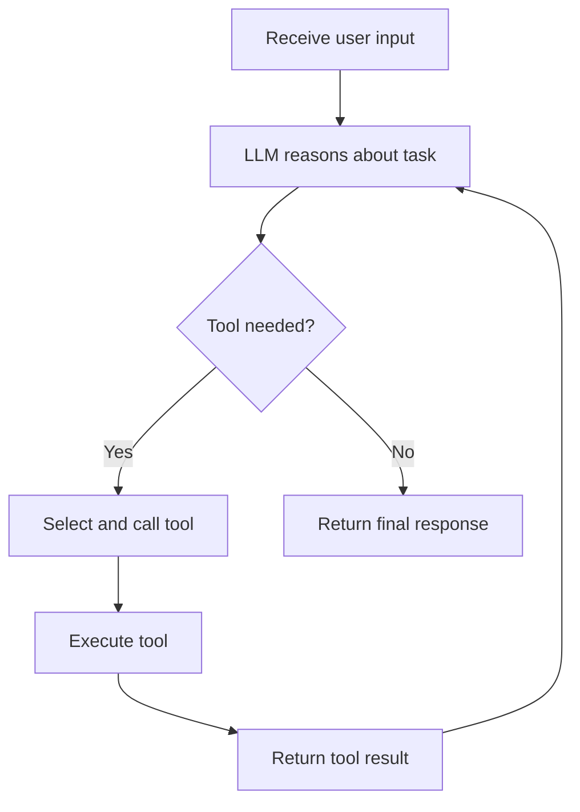
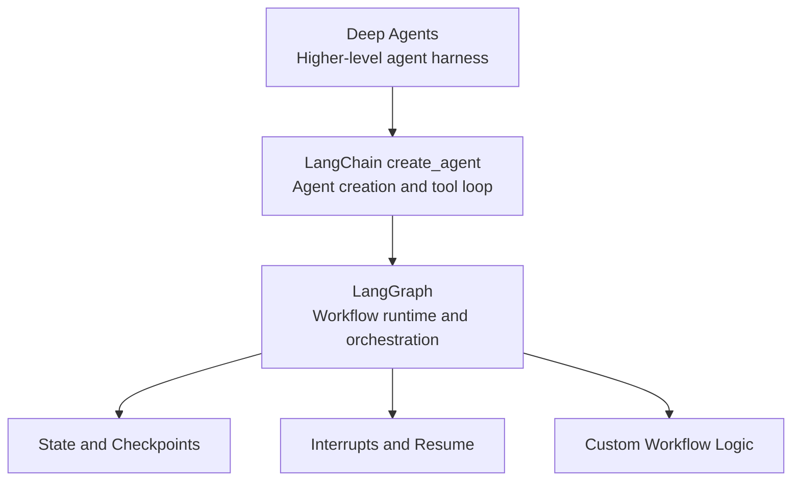
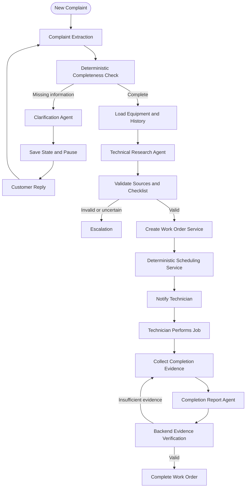
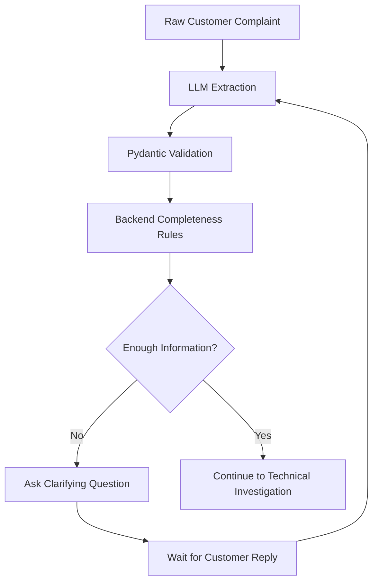
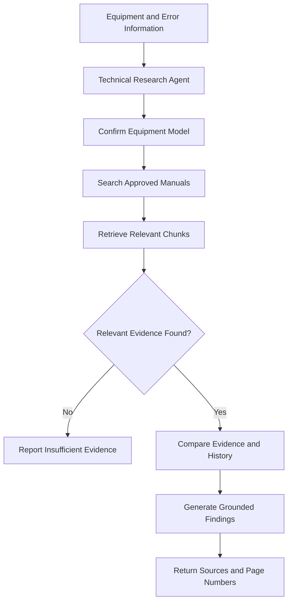
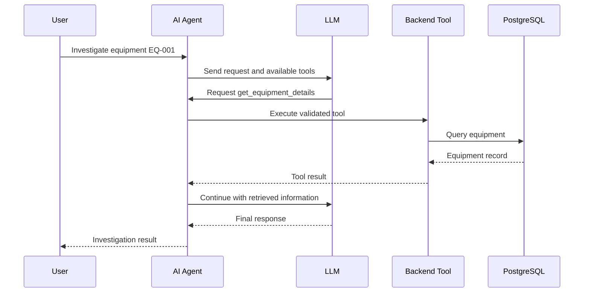
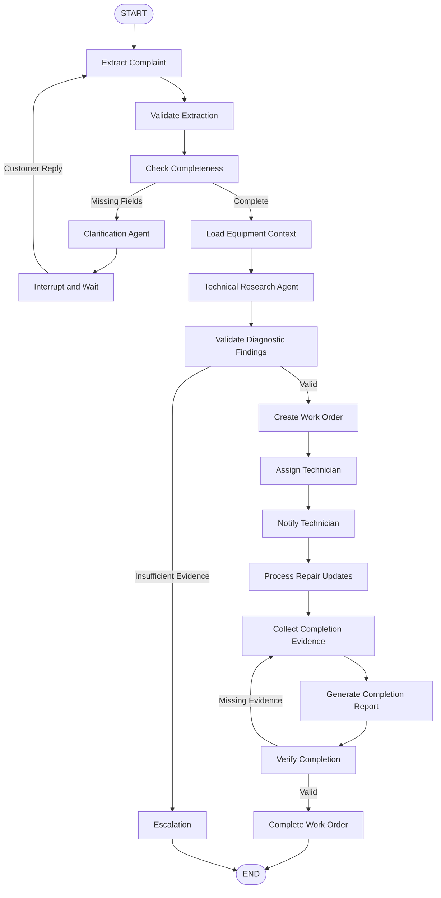
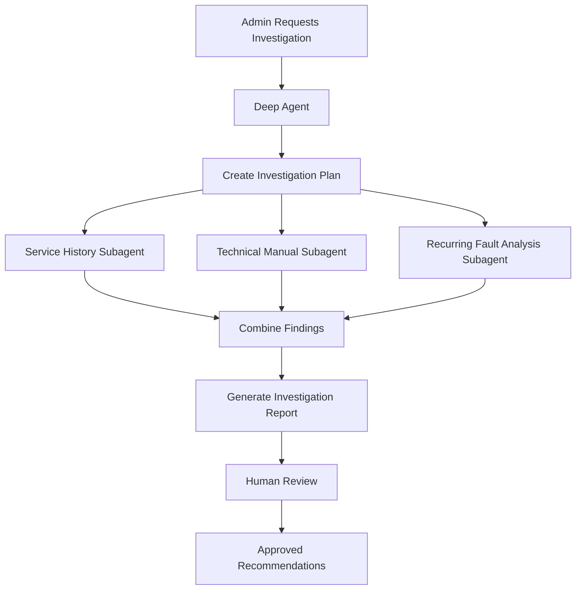

# FieldOps AI — AI System and Agent Architecture

**FieldOps AI: Autonomous Field-Service Coordination Platform**

This document defines how FieldOps AI actually thinks, makes decisions, uses tools and coordinates work. It is one of the most important parts of the design.

Not every agent should automatically be built from scratch using manually defined LangGraph nodes. LangChain provides higher-level abstractions such as `create_agent`, and the LangChain ecosystem also includes Deep Agents for more complex, longer-running tasks. These should be evaluated alongside LangGraph rather than assuming that a custom graph is always the best choice.

> The objective is to choose the simplest architecture that satisfies FieldOps AI's requirements.

**Contents**

1. [The three approaches](#1-the-three-approaches)
2. [What is `create_agent`?](#2-what-exactly-is-create_agent)
3. [What is Deep Agents?](#3-what-is-deep-agents)
4. [LangChain, LangGraph and Deep Agents compared](#4-the-difference-between-langchain-langgraph-and-deep-agents)
5. [Recommended architecture: hybrid LangGraph + `create_agent`](#5-recommended-architecture-hybrid-langgraph--create_agent)
6. [Complaint-understanding pipeline](#6-designing-the-complaint-understanding-pipeline)
7. [Customer clarification agent](#7-designing-the-customer-clarification-agent)
8. [Technical research agent with RAG](#8-designing-the-technical-research-agent-with-rag)
9. [Tool calling](#9-tool-calling--how-agents-interact-with-the-backend)
10. [LangGraph state](#10-designing-the-langgraph-state)
11. [The LangGraph workflow](#11-designing-the-langgraph-workflow)
12. [Pausing and resuming the workflow](#12-pausing-and-resuming-the-workflow)
13. [Completion report generation](#13-completion-report-generation)
14. [Where Deep Agents might fit later](#14-where-deep-agents-might-fit-in-fieldops-ai-later)
15. [Handling AI failures](#15-handling-ai-failures-and-unreliable-outputs)
16. [Evaluating the AI system](#16-evaluating-the-ai-system)
17. [Final architecture decision](#17-final-architecture-decision)
18. [Official documentation](#18-official-documentation)

---

## 1. The three approaches

| Approach | What it gives | Best suited for |
| --- | --- | --- |
| `create_agent` | A prebuilt tool-using agent with a model, tools and middleware | General-purpose agent tasks |
| Custom LangGraph workflow | Explicit nodes, transitions, branching and state management | Predictable, controlled business workflows |
| Deep Agents | A higher-level agent framework with planning, delegation and additional capabilities | Complex, multi-step tasks involving substantial context and work |

These are not three completely unrelated technologies. LangChain's agent abstractions are built on LangGraph's runtime, and Deep Agents builds on the same broader ecosystem.

The important question is not which one is most advanced. It is which one gives the right balance of autonomy, control, reliability and development complexity.

## 2. What exactly is `create_agent`?

`create_agent` is LangChain's higher-level API for building a tool-using AI agent. Instead of manually defining the model node, the tool-execution node and the loop between them, LangChain is given:

- A language model.
- A set of tools.
- A system prompt.
- Optional middleware and structured-output configuration.

LangChain constructs the agent loop. The basic execution pattern:



For example, the agent receives:

> The inverter is showing error E-05. Find the relevant manual information and prepare a technician checklist.

It may decide to:

1. Call `get_equipment`.
2. Call `search_manual`.
3. Examine the retrieved manual sections.
4. Call a checklist-generation tool or produce structured output.
5. Return the result.

This is an agent because the model chooses which available tools to use and can continue reasoning based on their results. LangChain documents `create_agent` as a prebuilt agent architecture using a ReAct-style tool loop on the LangGraph runtime.

### What `create_agent` saves from building

Without `create_agent`, the following would be implemented manually:

- Model invocation.
- Tool-call detection.
- Tool execution.
- Tool-result handling.
- Repeated model invocation.
- Stop conditions.

With `create_agent`, LangChain handles the standard agent loop, and the focus shifts to defining reliable tools, prompts, state, validation and permissions.

### Basic Python example

A simplified example using the current LangChain Python API:

```python
from langchain.agents import create_agent
from langchain.tools import tool


@tool
def get_equipment(equipment_id: str) -> dict:
    """Retrieve equipment details using its ID."""
    # In the real application, call an authorized
    # backend service or repository here.
    return {
        "equipment_id": equipment_id,
        "manufacturer": "Example Manufacturer",
        "model": "INV-5000"
    }


@tool
def search_manual(
    manufacturer: str,
    model: str,
    error_code: str
) -> dict:
    """Search approved technical manuals."""
    # Real implementation uses the RAG service.
    return {
        "model": model,
        "error_code": error_code,
        "sources": []
    }


agent = create_agent(
    model="YOUR_PROVIDER:YOUR_MODEL",
    tools=[get_equipment, search_manual],
    system_prompt=(
        "You help prepare field-service work. "
        "Use the available tools and never invent technical facts."
    )
)
```

The model string is a placeholder. The corresponding provider integration and credentials must be configured before running this example.

The example tools are also deliberately simplified. In the real application, they must use authenticated database access, equipment-model filtering, source citations and error handling.

### What is middleware?

Middleware customizes what happens around the agent loop. For FieldOps AI, useful middleware capabilities include:

- Checking tool permissions.
- Logging agent actions.
- Limiting the number of model/tool iterations.
- Redacting sensitive information.
- Requiring approval for selected tool calls.
- Modifying context before it reaches the model.

A production agent needs more than a prompt. It needs controls around its execution. LangChain supports middleware hooks and human-in-the-loop policies as part of its agent architecture.

## 3. What is Deep Agents?

Deep Agents is a higher-level agent harness built on LangChain and LangGraph. It is designed for tasks that involve substantial planning, context management, delegation and long-running execution. It provides capabilities such as:

- Task planning and todo management.
- Subagent delegation.
- Virtual filesystem tools.
- Context compression and management.
- Long-term memory capabilities.
- Human approval and interruption mechanisms.

A normal agent can use tools to complete a task. A deep agent has additional infrastructure to plan, divide, organize and manage more complicated tasks.

For example, consider asking an agent:

> Investigate why this solar installation has had repeated failures over the last six months. Review its service history, inspect the relevant manuals, compare previous technician findings and prepare an investigation report.

This task may involve many documents, multiple information sources and substantial intermediate results. A Deep Agent could plan the investigation, delegate independent research tasks to subagents, maintain progress and combine the results. The official Deep Agents documentation describes it as an agent harness for complex, multi-step work, with planning, context management, subagents and memory.

### Basic Deep Agent example

The Python package is `deepagents`, and its high-level creation function is `create_deep_agent`.

```python
from deepagents import create_deep_agent


def get_service_history(equipment_id: str) -> str:
    """Retrieve previous service records for equipment."""
    return f"Service history for {equipment_id}"


def search_technical_manual(query: str) -> str:
    """Search approved manufacturer manuals."""
    return f"Relevant manual sections for: {query}"


agent = create_deep_agent(
    model="YOUR_PROVIDER:YOUR_MODEL",
    tools=[
        get_service_history,
        search_technical_manual
    ],
    system_prompt=(
        "You investigate field-service problems. "
        "Use verified records and technical sources. "
        "Clearly distinguish evidence from hypotheses."
    )
)

result = agent.invoke({
    "messages": [
        {
            "role": "user",
            "content": (
                "Investigate repeated failures of equipment EQ-001."
            )
        }
    ]
})
```

This is a conceptual starting example. Real tool implementations need database access, authorization, validation and appropriate error handling.

### Does FieldOps AI need Deep Agents?

Not necessarily. FieldOps AI has some complex operations, but complexity alone does not justify a more autonomous framework. Most of its core workflow is structured:

- Receive complaint.
- Extract information.
- Check completeness.
- Ask questions if necessary.
- Retrieve manuals.
- Generate checklist.
- Validate work order.
- Assign technician.
- Verify completion.

The expected business process and the conditions for moving between stages are already known. Giving a Deep Agent unrestricted freedom to decide how to execute every stage would add unnecessary complexity. There is also a risk that its planning and delegation capabilities introduce unpredictable execution paths into a process that needs strong operational guarantees.

> For the FYP, Deep Agents should not be the primary orchestration framework.

## 4. The difference between LangChain, LangGraph and Deep Agents

They can be thought of as three levels of abstraction.



### LangGraph — the runtime and orchestration foundation

- Graph nodes and edges.
- State management.
- Conditional routing.
- Persistence and checkpoints.
- Interrupts and workflow resumption.
- Deterministic and agentic workflow combinations.

It is the foundation used when explicit control over execution is needed.

### LangChain — the agent-building layer

- `create_agent`.
- Model integrations.
- Tool abstractions.
- Structured outputs.
- Middleware.
- Human-in-the-loop agent controls.

It makes building standard agents easier.

### Deep Agents — the higher-level agent harness

- Planning.
- Context management.
- Subagents.
- Filesystem-based context handling.
- Memory and skills.
- Additional execution and approval capabilities.

The official architecture documentation describes this layering: Deep Agents builds on LangChain, while LangChain agents use LangGraph's runtime.

> **A common misunderstanding:** `create_agent` is not a replacement for LangGraph. It creates an agent graph using LangGraph underneath. A prebuilt agent can be used inside a larger custom LangGraph workflow, which is particularly useful for FieldOps AI.

## 5. Recommended architecture: hybrid LangGraph + `create_agent`

After considering the three approaches, the recommendation is a hybrid architecture:

- Use a **custom LangGraph workflow** for the overall business process.
- Use **`create_agent`** for bounded tasks where the LLM needs to reason and use tools.
- Keep **ordinary Python services** responsible for deterministic operations.
- **Do not introduce Deep Agents** into the initial MVP.

FieldOps AI has two fundamentally different kinds of work.

**Type A: predictable operations**

- Check whether required complaint fields are present.
- Validate equipment ownership.
- Create a work order.
- Check technician availability.
- Update a job status.
- Verify required completion evidence.

These should use normal Python code and database transactions.

**Type B: reasoning operations**

- Interpret an ambiguous complaint.
- Determine which information is missing.
- Search for relevant technical documentation.
- Compare technician findings with manual instructions.
- Summarize a repair report.

These benefit from LLM reasoning and, in some cases, agent tool use. The architecture should combine both.



This architecture allows agentic behavior where useful without making the entire business process dependent on unpredictable LLM decisions.

### Which component uses which approach

| FieldOps AI component | Recommended implementation |
| --- | --- |
| Overall complaint lifecycle | Custom LangGraph |
| Complaint extraction | LLM with structured output |
| Customer clarification | `create_agent` or bounded LLM workflow |
| Technical manual investigation | `create_agent` with restricted RAG tools |
| Work-order creation | Python service |
| Technician scheduling | Python service |
| Repair report generation | LLM with structured output |
| Completion verification | Python validation + optional LLM assessment |
| Complex historical investigations | Potential future Deep Agent |

This is the architecture to defend in an FYP design review, because every component has a clear reason to exist.

## 6. Designing the complaint-understanding pipeline

Suppose a customer submits:

> My solar system is not producing electricity. The inverter is showing a red light. It started yesterday.

The first job of the LLM is not to diagnose the fault. It is to understand and structure the information, using a predictable output schema.

### Step 1 — Define a Pydantic schema

```python
from pydantic import BaseModel, Field
from typing import Optional


class ComplaintExtraction(BaseModel):
    equipment_type: Optional[str] = None
    manufacturer: Optional[str] = None
    model: Optional[str] = None

    symptoms: list[str] = Field(
        default_factory=list
    )

    reported_error_code: Optional[str] = None
    onset_description: Optional[str] = None

    missing_information: list[str] = Field(
        default_factory=list
    )

    safety_concern: bool = False

    confidence_notes: list[str] = Field(
        default_factory=list
    )
```

Pydantic is used because the model's output should follow a defined structure rather than arrive as arbitrary paragraphs.

### Step 2 — Expected structured output

For the example complaint:

```json
{
  "equipment_type": "solar_inverter",
  "manufacturer": null,
  "model": null,
  "symptoms": [
    "system not producing electricity",
    "red warning light"
  ],
  "reported_error_code": null,
  "onset_description": "started yesterday",
  "missing_information": [
    "inverter manufacturer",
    "inverter model",
    "displayed error code"
  ],
  "safety_concern": false,
  "confidence_notes": [
    "The customer reported symptoms, not a confirmed cause."
  ]
}
```

Notice that the LLM did not invent a manufacturer, model or error code. That is exactly the desired behavior.

### Step 3 — Validate the output

The application should:

1. Parse the model response into the Pydantic schema.
2. Reject malformed output.
3. Check required fields.
4. Verify equipment identifiers against PostgreSQL.
5. Save the extraction result with appropriate provenance.

A model-generated confidence value should not be treated as proof of correctness. Confidence should be evaluated against real validation and test data.

### Why not ask the LLM to generate a complete work order immediately?

Because the system does not yet have enough verified information. A staged pipeline is needed:



This separation makes the system easier to debug and test.

## 7. Designing the customer clarification agent

Suppose the customer has not provided the inverter model or error code. The agent should ask targeted questions instead of making assumptions. For example:

> Could you share the inverter's manufacturer and model number? Also, if an error code is visible on the display, please send a photo of it.

### Tools for this agent

A bounded agent can be created with `create_agent`. Its tools might include:

| Tool | Responsibility |
| --- | --- |
| `get_complaint_context` | Retrieve complaint and previously supplied information |
| `get_equipment_details` | Retrieve registered equipment |
| `get_missing_fields` | Check which required information is missing |
| `send_customer_message` | Send a clarification request |
| `save_customer_response` | Save new information after validation |

There is an architectural distinction here: **the backend determines which fields are mandatory.** The LLM decides how to phrase the question, not whether an important safety or identification requirement can be ignored.

### Example interaction

> **Customer:** My inverter isn't working.
>
> **Agent:** Can you tell me the inverter's brand and model?
>
> **Customer:** It's a Solis 5kW inverter.
>
> **Agent:** Thank you. Is there an error code on the display?
>
> **Customer:** It says E-05.

The system now has additional information. It should validate that the equipment details match the customer's registered equipment, where applicable, and update the complaint record.

### Should this be a separate agent?

It can be, but a permanently running agent for every conversation is not needed. A clarification node in LangGraph can invoke a bounded `create_agent` when natural-language clarification is needed. That keeps the overall workflow manageable.

## 8. Designing the technical research agent with RAG

This is where FieldOps AI becomes more than a general-purpose chatbot: it works with equipment-specific technical documentation. Assume the customer has a registered inverter:

```
Manufacturer: Solis
Model: S5-GR1P5K
Error Code: E-05
```

The system must retrieve information relevant to that exact model and its approved documentation.

### Tools for the technical research agent

| Tool | Purpose |
| --- | --- |
| `get_equipment_details` | Confirm the equipment model |
| `get_service_history` | Retrieve previous repair records |
| `search_manual` | Search relevant manual sections |
| `get_document_page` | Retrieve a specific source page |
| `get_error_code_information` | Retrieve documented error-code information |

The agent should not have unrestricted SQL access. Each tool should expose a narrow, validated operation.

### How the research agent works



### What the agent should return

Structured findings, not just a paragraph. For example:

```json
{
  "equipment_model": "S5-GR1P5K",
  "reported_error_code": "E-05",
  "evidence_found": true,
  "findings": [
    {
      "statement": "Relevant manual section retrieved.",
      "source_document": "approved-manual.pdf",
      "page": 42
    }
  ],
  "uncertainties": [],
  "requires_escalation": false
}
```

This example does not assert what E-05 actually means. The actual finding must come from the verified manual.

### Important RAG design rules

1. Filter retrieval by manufacturer and model.
2. Use approved document versions.
3. Keep original page references.
4. Return source evidence with each important finding.
5. Distinguish retrieved facts from AI-generated interpretations.
6. Escalate when evidence is insufficient or contradictory.

A high similarity score alone does not establish that a retrieved passage is technically correct.

## 9. Tool calling — how agents interact with the backend

This is probably the most important practical skill when building an agentic application. An LLM cannot magically access the PostgreSQL database, create work orders or send WhatsApp messages. Selected backend operations are exposed as tools. For example:

```python
from langchain.tools import tool


@tool
def get_equipment_details(
    equipment_id: str
) -> dict:
    """Retrieve equipment details by equipment ID."""
    # Call the equipment service.
    return {
        "equipment_id": equipment_id,
        "manufacturer": "Example Manufacturer",
        "model": "INV-5000"
    }
```

The agent can request this tool when it needs equipment information. The execution flow:



### Tool permissions are critical

Read operations must be distinguished from operations that change business records.

| Tool | Risk | Control |
| --- | --- | --- |
| `get_equipment_details` | Low | Ownership and authorization checks |
| `search_manual` | Low | Approved document filters |
| `get_service_history` | Moderate | Customer and equipment access checks |
| `send_customer_message` | Moderate | Channel, recipient and duplicate-send checks |
| `create_work_order` | High | Schema validation, uniqueness and business rules |
| `assign_technician` | High | Skills, availability and transaction checks |
| `update_work_order_status` | High | Valid transition and role checks |

> The LLM may request a tool, but the backend must decide whether that operation is allowed. The agent must never be given a general-purpose database connection or an unrestricted SQL execution tool.

### Human-in-the-loop with `create_agent`

LangChain provides `HumanInTheLoopMiddleware`, which can interrupt selected tool calls and request an approval decision. For example, a work-order cancellation tool can be configured to require approval. Conceptually:

```python
from langchain.agents import create_agent
from langchain.agents.middleware import (
    HumanInTheLoopMiddleware
)

agent = create_agent(
    model="YOUR_PROVIDER:YOUR_MODEL",
    tools=[
        get_equipment_details,
        create_work_order,
        cancel_work_order
    ],
    middleware=[
        HumanInTheLoopMiddleware(
            interrupt_on={
                "get_equipment_details": False,
                "create_work_order": False,
                "cancel_work_order": True
            }
        )
    ]
)
```

This is an illustrative policy. Whether work-order creation can proceed without approval must depend on the backend's validation and business rules.

The middleware controls approval at the agent-tool level. It does not replace authorization checks inside the actual backend service. LangChain supports approve, edit and reject decisions for interrupted tool calls, with the workflow state persisted for resumption.

## 10. Designing the LangGraph state

LangGraph uses a state object to maintain information between nodes. For FieldOps AI, something like this is needed:

```python
from typing import TypedDict


class FieldOpsState(TypedDict):
    complaint_id: str
    customer_id: str
    equipment_id: str | None

    original_complaint: str
    extracted_data: dict
    missing_information: list[str]

    conversation_history: list[dict]

    equipment_details: dict
    service_history: list[dict]
    retrieved_documents: list[dict]

    diagnostic_checklist: list[dict]

    work_order_id: str | None
    technician_id: str | None

    escalation_required: bool
    escalation_reason: str | None

    workflow_status: str
```

This is a simplified state schema that will be refined during implementation.

### Why state is needed

Imagine this sequence:

1. Customer submits a complaint.
2. AI extracts information.
3. AI discovers the model number is missing.
4. AI asks the customer for the model number.
5. Customer replies three hours later.

Without persisted state, the entire workflow may need to be reconstructed from scratch. With LangGraph persistence, the workflow can resume with the previous context.

### State is not the database

Every customer record, message and PDF should not be put into LangGraph state. State should stay relatively small and store identifiers, workflow progress and selected information needed for the current execution. Full records are retrieved from PostgreSQL or object storage when required.

Each node's state updates also need to be defined. LangGraph uses state-update semantics and reducers; careless updates to message lists or parallel outputs can overwrite or duplicate information.

## 11. Designing the LangGraph workflow

The main nodes:

| Node | Responsibility |
| --- | --- |
| `extract_complaint` | Extract structured information |
| `validate_extraction` | Validate model output |
| `check_completeness` | Check required fields |
| `clarification_agent` | Generate targeted customer questions |
| `wait_for_customer` | Pause for external input |
| `load_equipment_context` | Retrieve equipment and history |
| `technical_research_agent` | Search manuals and prepare findings |
| `validate_diagnostic_result` | Check sources and required evidence |
| `create_work_order` | Call validated backend service |
| `assign_technician` | Execute deterministic scheduling |
| `process_completion` | Collect repair information |
| `generate_completion_report` | Produce structured report |
| `verify_completion` | Check evidence and business rules |
| `escalate` | Route uncertain or exceptional cases |

### The complete workflow



### Why not make every node an agent?

Because most nodes don't require reasoning. For example, `check_completeness` can be ordinary Python code:

```python
def check_completeness(state):
    required_fields = [
        "equipment_type",
        "model",
        "symptoms"
    ]

    data = state["extracted_data"]

    missing = [
        field
        for field in required_fields
        if not data.get(field)
    ]

    return {
        "missing_information": missing
    }
```

This is more predictable than asking an LLM to decide whether the required information exists.

> Use an agent when a task genuinely needs model reasoning or flexible tool selection. Use normal functions when the rules are known.

## 12. Pausing and resuming the workflow

This is a core feature for FieldOps AI. The workflow may need to pause when:

- The customer hasn't provided the equipment model.
- A technician must review a safety-sensitive finding.
- An administrator must approve an exception.
- Required completion evidence is missing.

LangGraph provides an `interrupt()` mechanism for this. Conceptually:

```python
from langgraph.types import interrupt


def wait_for_customer(state):
    answer = interrupt({
        "reason": "missing_equipment_information",
        "question": (
            "Please provide your inverter model."
        )
    })

    return {
        "customer_response": answer
    }
```

The graph pauses and saves its state through the configured checkpointer. Later, the application resumes the same workflow using the same `thread_id` and a `Command` carrying the new response.

The `thread_id` is the identifier used to retrieve the correct persisted workflow state. It must remain stable for that complaint workflow. LangGraph documents this checkpoint-and-resume behavior, including the use of `interrupt()` and `Command`.

### How this works with WhatsApp

1. Customer sends a complaint.
2. LangGraph extracts information.
3. LangGraph interrupts because information is missing.
4. The application saves the question and sends it through WhatsApp.
5. The Celery task finishes.
6. Customer replies.
7. FastAPI receives the webhook.
8. The application validates and stores the response.
9. A new Celery task resumes the same LangGraph thread.
10. The workflow continues.

A new workflow thread must not be created for every customer message. The application needs a reliable mapping between the complaint and its LangGraph thread.

Resuming a graph is also not equivalent to submitting a new chat message. The state update or resume command that feeds the customer's answer into the paused node must be implemented explicitly.

### A subtle but important implementation issue

LangGraph nodes can be retried or re-executed after interruption or failure. If a node sends a WhatsApp message or creates a work order, it must not accidentally perform the same external action twice. Use:

- Idempotency keys.
- Unique database constraints.
- Transactional writes.
- External action records.
- Carefully designed node boundaries.

For example, before creating a work order, the backend should check whether one already exists for the complaint. The database should also enforce the one-work-order-per-complaint rule if that is the chosen business constraint.

## 13. Completion report generation

A technician completes the repair and submits notes such as:

```
Customer reported that the inverter was not generating electricity.

Inspected the equipment and recorded the displayed error code.
Followed the applicable manufacturer service procedure.
Performed the approved repair.
Submitted post-repair test measurements and photographs.
```

The LLM can transform this into a structured completion report. Example schema:

```python
from pydantic import BaseModel
from typing import Optional


class CompletionReport(BaseModel):
    reported_problem: str
    technician_findings: list[str]
    work_performed: list[str]
    parts_used: list[str]
    test_results: list[str]
    unresolved_issues: list[str]
    recommended_follow_up: Optional[str] = None
```

But generating a report does not prove that the repair succeeded. The backend must check:

- Is the required technician evidence present?
- Are required measurements included?
- Are photographs attached where required?
- Does the technician have permission to submit completion?
- Are there unresolved issues?
- Is the work-order status transition valid?

Only then should the system close the job. This is a critical distinction between generating information and verifying an operational result.

## 14. Where Deep Agents might fit in FieldOps AI later

Deep Agents is not recommended for the main complaint lifecycle in the first MVP. There is, however, a valuable future use case.

### Feature: Autonomous Maintenance Investigation

Suppose a solar company has 500 pieces of equipment and wants to investigate recurring failures. An administrator asks:

> Investigate all recurring inverter failures from the last three months. Identify equipment with repeated faults, compare technician findings, retrieve relevant manufacturer documentation and prepare a maintenance-risk report.

This is more complicated than processing one complaint. A Deep Agent could:

1. Create an investigation plan.
2. Retrieve historical service records.
3. Delegate independent equipment investigations to subagents.
4. Search relevant manufacturer documentation.
5. Compare findings.
6. Consolidate results into a report.
7. Request human review before making operational recommendations.



Subagents are useful when subtasks can be independently investigated and their detailed intermediate work does not need to fill the main agent's context.

This could become a strong advanced feature, but it should be a later development phase, not a requirement for the initial FYP.

## 15. Handling AI failures and unreliable outputs

A real agentic system must handle situations where the AI does not produce the expected result.

| Failure | Recommended handling |
| --- | --- |
| Invalid structured output | Retry with validation feedback, then escalate |
| Equipment model not identified | Ask customer for clarification |
| No relevant manual found | Report insufficient evidence |
| Conflicting manual information | Escalate for technical review |
| LLM API unavailable | Retry with backoff, preserve workflow state |
| Tool execution fails | Return a controlled error and retry if safe |
| Duplicate tool call | Enforce idempotency |
| Technician unavailable | Search for another eligible technician |
| Completion evidence missing | Keep work order open |
| AI generates unsupported diagnosis | Reject or flag the result |

### A critical rule: never let the agent hide uncertainty

If a manual search returns no reliable result, the agent must not invent an error-code explanation just to complete the workflow. A good response is:

> I could not find a verified explanation for this error code in the approved documentation. This case requires technical review.

That is better than a confident but incorrect diagnosis.

## 16. Evaluating the AI system

It also needs to be demonstrated that FieldOps AI actually works. Simply showing a working chatbot is not enough for a Generative AI / Agentic AI FYP. The following areas should be evaluated:

| Component | Evaluation metric |
| --- | --- |
| Complaint extraction | Field-level precision, recall and F1 |
| Equipment identification | Correct identification rate |
| Clarification | Percentage of required missing fields successfully collected |
| RAG | Recall@K, source relevance and citation correctness |
| Checklist generation | Technical grounding and expert review |
| Tool calling | Successful and correct tool execution rate |
| Work-order creation | Valid record creation and duplicate prevention |
| Scheduling | Constraint satisfaction and assignment success |
| Completion reports | Factual consistency with technician evidence |
| Workflow reliability | Successful completion, recovery and escalation rates |

### Example test dataset

A dataset of 100 test complaints:

- 25 complete complaints.
- 25 incomplete complaints.
- 20 complaints with photos or error codes.
- 15 complaints with ambiguous descriptions.
- 15 complaints involving unsupported or conflicting information.

These are suggested test proportions, not real-world distribution estimates. For each test, an expected result should be prepared manually or with expert assistance. For example:

| Input | Expected system behavior |
| --- | --- |
| Model and symptoms provided | Extract and continue |
| Model missing | Ask clarification |
| Unknown error code | Avoid unsupported diagnosis |
| Manual not available | Escalate |
| Duplicate webhook | Process only once |
| Technician rejects assignment | Find another eligible technician |
| Missing repair evidence | Do not close work order |

This testing demonstrates reliability rather than merely showing that an LLM can generate convincing responses.

## 17. Final architecture decision

### Recommended AI architecture for the FYP MVP

1. **Custom LangGraph workflow** controls the complete complaint-to-work-order-to-completion lifecycle.
2. **LangChain `create_agent`** is used for bounded tasks involving flexible reasoning and tool selection, especially technical research and selected clarification tasks.
3. **Deep Agents** are reserved for future complex investigations involving planning, delegation and large amounts of information.
4. **Deterministic Python services** handle validation, work-order creation, technician scheduling, permissions and completion verification.
5. **PostgreSQL + LangGraph persistence:** PostgreSQL stores business records; LangGraph checkpoints preserve resumable workflow state.

### Recommended Python dependencies

For the initial implementation, evaluate these packages:

```bash
pip install \
    langchain \
    langgraph \
    langchain-openai \
    deepagents \
    langchain-postgres \
    sqlalchemy \
    psycopg \
    pgvector \
    pydantic
```

Not all of these are needed immediately.

- `langchain`: agent abstractions and tools.
- `langgraph`: workflow orchestration and persistence.
- `langchain-openai`: example provider integration; replace it if another provider is selected.
- `deepagents`: optional future experimentation.
- `langchain-postgres`: PostgreSQL integrations, including vector-store capabilities.
- `sqlalchemy`: application database access.
- `psycopg`: PostgreSQL driver.
- `pgvector`: vector support.
- `pydantic`: structured validation.

Before implementation, compatible package versions should be pinned and the matching documentation followed. LangChain APIs evolve, so old tutorials should not be combined with current APIs without checking their compatibility.

## 18. Official documentation

Primary references to keep alongside the project documentation.

**LangChain documentation**

- [Agents and `create_agent`](https://docs.langchain.com/oss/python/langchain/agents)
- [Deep Agents overview](https://docs.langchain.com/oss/python/deepagents/overview)
- [Agent middleware](https://docs.langchain.com/oss/python/langchain/middleware)

**LangGraph documentation**

- [Graph API](https://docs.langchain.com/oss/python/langgraph/graph-api)
- [Persistence and checkpoints](https://docs.langchain.com/oss/python/langgraph/persistence)
- [Interrupts and human-in-the-loop](https://docs.langchain.com/oss/python/langgraph/interrupts)

**LangSmith**

- [Observability and tracing](https://docs.langchain.com/langsmith/observability)
- [Evaluation](https://docs.langchain.com/langsmith/evaluation)

LangSmith is worth considering for tracing agent runs, inspecting tool calls and debugging failures. It is not mandatory for the first prototype.
