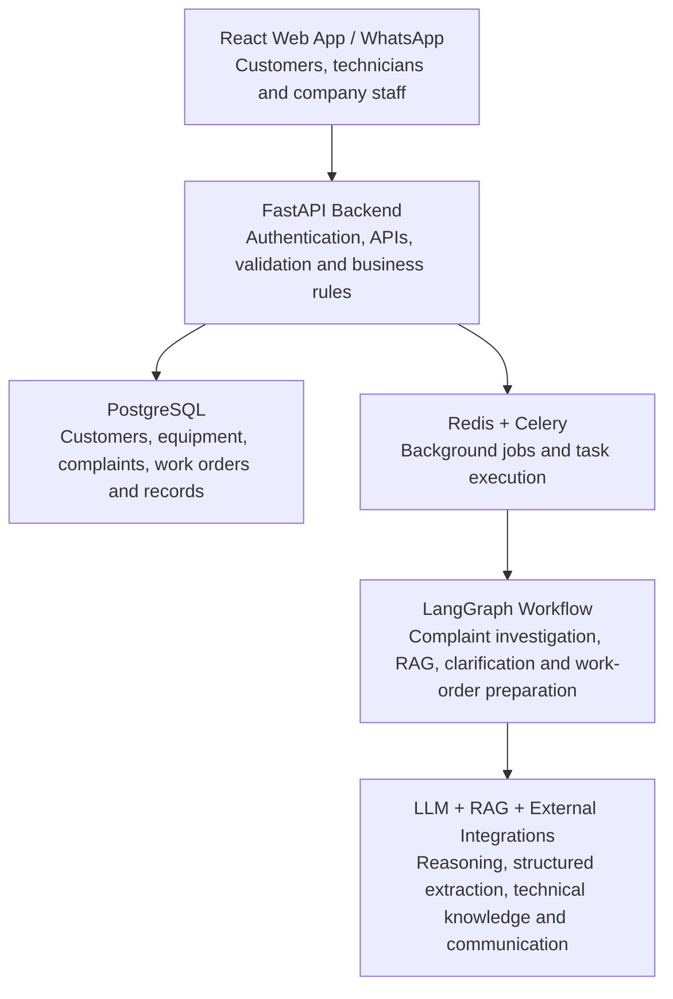
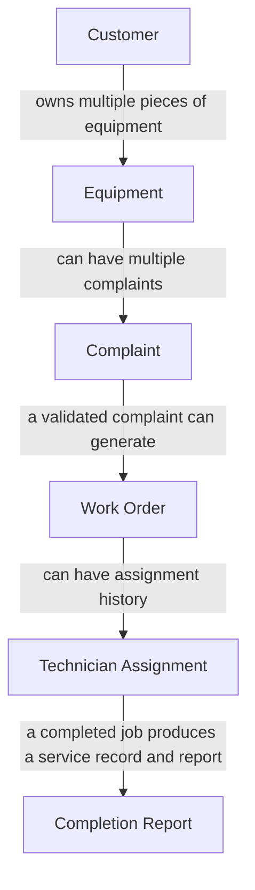

# FieldOps AI — Backend Engineering: FastAPI, PostgreSQL and Database Design

**FieldOps AI: Autonomous Field-Service Coordination Platform**

This document covers building the actual software foundation of FieldOps AI. The AI components understand complaints, retrieve technical information, generate diagnostic checklists and coordinate work. The question here is different:

> How is a reliable backend built that manages customers, complaints, equipment, work orders, technicians and AI workflows without losing data or allowing the AI to make unauthorized changes?

The central principle:

> **The backend owns business data and business rules. The AI helps make decisions, but it does not become the source of truth.**

For example, an AI agent may recommend assigning a solar technician to a complaint. The backend must verify that the technician is qualified, available, authorized, and not already assigned to a conflicting job.

**Contents**

1. [The backend's responsibility](#1-the-backends-responsibility)
2. [FastAPI — the backend framework](#2-fastapi--the-backend-framework)
3. [PostgreSQL — designing the database](#3-postgresql--designing-the-database)
4. [Authentication and authorization](#4-authentication-and-authorization)
5. [REST API design](#5-rest-api-design)
6. [Complaint and work-order lifecycle](#6-complaint-and-work-order-lifecycle)
7. [Celery and Redis — background processing](#7-celery-and-redis--background-processing)
8. [Integrating LangGraph with the backend](#8-integrating-langgraph-with-the-backend)
9. [Transactions and concurrency](#9-transactions-and-concurrency--preventing-serious-bugs)
10. [Database migrations with Alembic](#10-database-migrations-with-alembic)
11. [Security, logging and error handling](#11-security-logging-and-error-handling)
12. [Complete backend example](#12-how-everything-works-together--complete-backend-example)
13. [Recommended implementation order](#13-recommended-implementation-order)
14. [Final technology recommendations](#14-final-technology-recommendations)
15. [What to test](#15-what-to-test)
16. [Official documentation](#16-official-documentation)

---

## 1. The backend's responsibility

The backend is the central control system of FieldOps AI.



These components have different responsibilities:

| Component | Main responsibility |
| --- | --- |
| FastAPI | Exposes APIs and coordinates application operations |
| PostgreSQL | Stores authoritative business data |
| Redis | Supports queues and temporary coordination |
| Celery | Executes background tasks |
| LangGraph | Manages stateful AI workflows |
| LLM | Understands complaints and produces structured decisions |
| Object storage | Stores images, audio and documents |

One important distinction: Redis is not the primary database, and LangGraph is not a replacement for the backend.

## 2. FastAPI — the backend framework

FastAPI is a Python framework for building APIs. In FieldOps AI, React and WhatsApp communicate with the backend through HTTP APIs and webhooks. For example, when a customer submits a complaint:

```
POST /api/v1/complaints
Content-Type: application/json
```

Request body:

```json
{
  "equipment_id": "equipment-123",
  "description": "My solar inverter is showing a red light.",
  "channel": "web"
}
```

The backend should:

1. Authenticate the customer.
2. Validate the submitted information.
3. Verify that the customer has access to the equipment.
4. Create a complaint record in PostgreSQL.
5. Schedule the AI investigation as a background task.
6. Return a complaint ID and its initial status.

The backend should not keep the HTTP request open while an LLM performs a long investigation. It should accept the complaint, persist it, and let a background worker handle the longer process.

### Recommended project structure

For the FYP, a modular monolith is recommended: one FastAPI application organized into clear modules.

```
backend/
│
├── app/
│   ├── main.py
│   │
│   ├── api/
│   │   └── v1/
│   │       ├── auth.py
│   │       ├── complaints.py
│   │       ├── attachments.py
│   │       ├── work_orders.py
│   │       ├── technicians.py
│   │       └── webhooks.py
│   │
│   ├── core/
│   │   ├── config.py
│   │   ├── security.py
│   │   └── logging.py
│   │
│   ├── db/
│   │   ├── session.py
│   │   └── base.py
│   │
│   ├── models/
│   ├── schemas/
│   ├── services/
│   ├── repositories/
│   │
│   ├── workflows/
│   │   ├── graph.py
│   │   ├── state.py
│   │   └── nodes/
│   │
│   ├── agents/
│   ├── rag/
│   ├── tasks/
│   ├── domain/
│   └── integrations/
│
├── alembic/
├── tests/
├── requirements.txt
└── Dockerfile
```

What the directories mean:

- `api/`: HTTP endpoints and request handling.
- `models/`: SQLAlchemy database models.
- `schemas/`: Pydantic request and response schemas.
- `services/`: application operations, such as complaint creation and technician assignment.
- `repositories/`: database query logic, where separating it is useful.
- `workflows/`: LangGraph state, nodes and graph construction.
- `agents/`: agent definitions and tool configuration.
- `rag/`: document retrieval and knowledge-base logic.
- `tasks/`: Celery background tasks.
- `domain/`: business rules, statuses and domain exceptions.
- `integrations/`: WhatsApp, storage and LLM connections.

This is not a requirement to create dozens of empty files immediately. Modules should be built when needed; the purpose is separation of responsibilities, not folder complexity.

## 3. PostgreSQL — designing the database

PostgreSQL is the main database for FieldOps AI. This is an important design decision because the platform needs to maintain relationships between many entities. Imagine a solar maintenance company:

- One company has multiple customers.
- One customer can own multiple solar systems.
- One solar system can have multiple complaints over time.
- One complaint can generate a work order.
- One work order can have multiple technician assignment attempts.
- One completed work order can produce a service report.

These relationships should be represented properly in the database.

### 3.1 The main database tables

| Table | Purpose |
| --- | --- |
| `users` | Login accounts and roles |
| `customers` | Customer profiles |
| `technicians` | Technician profiles and skills |
| `equipment` | Solar inverters and other equipment |
| `complaints` | Customer-reported problems |
| `conversations` | Communication sessions |
| `messages` | Individual messages |
| `complaint_attachments` | Image and audio metadata |
| `documents` | Technical manuals and documents |
| `document_chunks` | RAG text chunks and embeddings |
| `work_orders` | Validated technical jobs |
| `technician_assignments` | Assignment history |
| `service_records` | Previous maintenance history |
| `completion_reports` | Repair results and evidence |

These are not necessarily the final tables; they will be refined as implementation requirements become clearer.

### 3.2 Understanding database relationships



A database relationship is enforced using a foreign key. For example:

```sql
CREATE TABLE customers (
    id UUID PRIMARY KEY,
    name VARCHAR(150) NOT NULL,
    phone VARCHAR(30) NOT NULL,
    created_at TIMESTAMPTZ DEFAULT NOW()
);

CREATE TABLE equipment (
    id UUID PRIMARY KEY,
    customer_id UUID NOT NULL
        REFERENCES customers(id),
    manufacturer VARCHAR(100),
    model VARCHAR(100),
    serial_number VARCHAR(100),
    created_at TIMESTAMPTZ DEFAULT NOW()
);

CREATE TABLE complaints (
    id UUID PRIMARY KEY,
    customer_id UUID NOT NULL
        REFERENCES customers(id),
    equipment_id UUID
        REFERENCES equipment(id),
    description TEXT NOT NULL,
    channel VARCHAR(30) NOT NULL,
    status VARCHAR(40) NOT NULL,
    created_at TIMESTAMPTZ DEFAULT NOW()
);
```

Notice that `equipment_id` in complaints is nullable. A customer might submit a complaint without knowing which equipment is affected, and the complaint shouldn't be rejected just because the equipment hasn't been identified yet. The AI workflow can ask the customer for clarification and update the complaint later.

### 3.3 Important PostgreSQL data types

| Type | Usage |
| --- | --- |
| `UUID` | IDs for customers, complaints and work orders |
| `VARCHAR` | Names, phone numbers, model numbers |
| `TEXT` | Complaint descriptions and notes |
| `BOOLEAN` | Availability flags |
| `TIMESTAMPTZ` | Dates and timestamps |
| `JSONB` | Flexible structured observations and metadata |
| `VECTOR` | Embeddings using pgvector |

`JSONB` should be used selectively. For example, it can store structured vision observations, but the entire relational database should not be put into JSON. For dates and timestamps, `TIMESTAMPTZ` is preferred so events can be represented consistently across different time zones.

### 3.4 SQLAlchemy — communicating with PostgreSQL

SQLAlchemy is the ORM used to interact with PostgreSQL from Python. Instead of writing SQL for every database operation, Python classes representing database tables are defined. Example using SQLAlchemy 2.0 style:

```python
import uuid

from sqlalchemy import String, ForeignKey
from sqlalchemy.orm import (
    DeclarativeBase,
    Mapped,
    mapped_column,
)


class Base(DeclarativeBase):
    pass


class Customer(Base):
    __tablename__ = "customers"

    id: Mapped[uuid.UUID] = mapped_column(
        primary_key=True,
        default=uuid.uuid4
    )

    name: Mapped[str] = mapped_column(
        String(150),
        nullable=False
    )

    phone: Mapped[str] = mapped_column(
        String(30),
        nullable=False
    )


class Equipment(Base):
    __tablename__ = "equipment"

    id: Mapped[uuid.UUID] = mapped_column(
        primary_key=True,
        default=uuid.uuid4
    )

    customer_id: Mapped[uuid.UUID] = mapped_column(
        ForeignKey("customers.id"),
        nullable=False
    )

    manufacturer: Mapped[str | None] = mapped_column(
        String(100)
    )

    model: Mapped[str | None] = mapped_column(
        String(100)
    )

    serial_number: Mapped[str | None] = mapped_column(
        String(100)
    )
```

This is a simplified example. In the actual application, relationships, indexes, constraints and timestamps will also be defined. SQLAlchemy handles the mapping between Python objects and database records, and its `Session` manages database operations and transactions.

### 3.5 SQLAlchemy models vs. Pydantic schemas

They serve different purposes.

| Feature | SQLAlchemy | Pydantic |
| --- | --- | --- |
| Main purpose | Database persistence | Data validation |
| Represents | Database tables | API and structured data |
| Used for | Saving and querying records | Validating incoming/outgoing data |
| Example | `Complaint` model | `ComplaintCreate` schema |

A Pydantic example:

```python
from pydantic import BaseModel, Field


class ComplaintCreate(BaseModel):
    equipment_id: str | None = None

    description: str = Field(
        min_length=5,
        max_length=5000
    )

    channel: str
```

The API validates the incoming request using Pydantic, then the application service creates a database record using SQLAlchemy. These two layers should not be confused.

## 4. Authentication and authorization

FieldOps AI has three primary user roles:

| Role | Responsibilities |
| --- | --- |
| Customer | Submit complaints, view own equipment and track jobs |
| Technician | View assigned jobs, update progress and submit repair evidence |
| Admin / Dispatcher | Manage technicians, equipment, assignments and operations |

Two separate security concepts are needed:

- **Authentication:** who are you?
- **Authorization:** what are you allowed to do?

For example:

- A customer can view their own complaints, not another customer's complaints.
- A technician can update jobs assigned to them, not every job in the company.
- An administrator can manage assignments and technician availability.

### Recommended authentication approach

Use JWT-based authentication with secure password hashing. A simplified login flow:

1. User submits email and password.
2. Backend retrieves the user's account.
3. Backend verifies the password against its stored hash.
4. Backend issues an access token.
5. User includes the token in subsequent API requests.
6. Backend validates the token and checks permissions.

Important security rules:

- Never store plaintext passwords.
- Use a maintained password-hashing library, such as `pwdlib` with Argon2.
- Keep signing secrets in environment variables or a secrets manager.
- Use token expiration and a deliberate refresh/revocation strategy.
- Validate access to individual records, not just the user's role.

JWT is signed, not encrypted. Passwords, sensitive personal data or confidential medical information must not be put inside JWT payloads.

For the FYP, implement role-based access control (RBAC) and ownership checks from the beginning. A role check alone is insufficient.

## 5. REST API design

The APIs the frontend and WhatsApp integration will use. These are proposed endpoints, not a requirement to implement everything immediately.

### Complaint APIs

| Method | Endpoint | Purpose |
| --- | --- | --- |
| POST | `/api/v1/complaints` | Submit a complaint |
| GET | `/api/v1/complaints` | List accessible complaints |
| GET | `/api/v1/complaints/{id}` | View complaint details |
| POST | `/api/v1/complaints/{id}/messages` | Send a follow-up message |
| POST | `/api/v1/complaints/{id}/attachments` | Upload an image or audio file |

### Work-order APIs

| Method | Endpoint | Purpose |
| --- | --- | --- |
| GET | `/api/v1/work-orders` | List accessible work orders |
| GET | `/api/v1/work-orders/{id}` | View a work order |
| POST | `/api/v1/work-orders/{id}/accept` | Accept a job |
| POST | `/api/v1/work-orders/{id}/status` | Update job status |
| POST | `/api/v1/work-orders/{id}/completion` | Submit completion evidence |

### Other APIs

| Method | Endpoint | Purpose |
| --- | --- | --- |
| GET | `/api/v1/technicians` | List eligible technicians |
| GET | `/api/v1/equipment/{id}` | View equipment information |
| POST | `/api/v1/webhooks/whatsapp` | Receive WhatsApp events |

### Example: complaint submission

A simplified FastAPI endpoint:

```python
from fastapi import APIRouter, Depends, status
from pydantic import BaseModel

router = APIRouter()


class ComplaintCreate(BaseModel):
    description: str
    equipment_id: str | None = None


@router.post(
    "/complaints",
    status_code=status.HTTP_202_ACCEPTED
)
async def create_complaint(
    data: ComplaintCreate,
    current_user=Depends(get_current_user),
):
    complaint = await complaint_service.create(
        customer_id=current_user.customer_id,
        description=data.description,
        equipment_id=data.equipment_id,
    )

    await enqueue_complaint_investigation(
        complaint.id
    )

    return {
        "complaint_id": str(complaint.id),
        "status": complaint.status,
        "message": "Complaint received"
    }
```

This is illustrative code; `complaint_service`, `get_current_user`, and the queue function need to be implemented.

Notice that the API does not ask the LLM to create the complaint directly. The backend creates the record and then schedules AI processing.

### Why HTTP 202?

`202 Accepted` communicates that the request has been accepted for processing, but the longer-running work has not necessarily finished. The frontend can then display:

```
Complaint received
AI investigation: Processing
```

Later, it can retrieve the updated status.

## 6. Complaint and work-order lifecycle

A reliable system needs clearly defined statuses. An LLM should not be free to invent or change statuses arbitrarily.

### Complaint lifecycle

```
RECEIVED
    |
    v
PROCESSING
    |
    v
NEEDS_INFORMATION
    |
    v
INVESTIGATING
    |
    v
READY_FOR_WORK_ORDER
    |
    v
WORK_ORDER_CREATED
```

Possible alternative outcomes: `CANCELLED`, `ESCALATED`, `REJECTED`.

### Work-order lifecycle

```
DRAFT
  |
  v
VALIDATED
  |
  v
ASSIGNED
  |
  v
ACCEPTED
  |
  v
IN_PROGRESS
  |
  +------> AWAITING_PARTS
  |              |
  |              v
  |         IN_PROGRESS
  |
  v
COMPLETION_REVIEW
  |
  v
COMPLETED
```

Possible alternative outcomes: `REASSIGNMENT_REQUIRED`, `ESCALATED`, `CANCELLED`.

The backend should enforce allowed transitions. For example:

- A technician cannot mark an unassigned job as completed.
- A work order cannot become completed without the required completion evidence.
- A cancelled work order cannot silently return to progress.
- A job awaiting parts must be resumed through an appropriate transition.

These rules should be implemented in a domain service rather than relying on an LLM prompt. A simple conceptual function:

```python
ALLOWED_TRANSITIONS = {
    "DRAFT": {"VALIDATED", "CANCELLED"},
    "VALIDATED": {"ASSIGNED", "CANCELLED"},
    "ASSIGNED": {"ACCEPTED", "REASSIGNMENT_REQUIRED"},
    "ACCEPTED": {"IN_PROGRESS"},
    "IN_PROGRESS": {
        "AWAITING_PARTS",
        "COMPLETION_REVIEW",
        "ESCALATED"
    },
    "AWAITING_PARTS": {"IN_PROGRESS"},
    "COMPLETION_REVIEW": {"COMPLETED", "IN_PROGRESS"}
}


def validate_transition(current, new):
    if new not in ALLOWED_TRANSITIONS.get(current, set()):
        raise ValueError("Invalid status transition")
```

This is a simplified starting point. The production implementation must also check the actor's permissions and required evidence.

## 7. Celery and Redis — background processing

This is one of the most important architectural decisions. Consider a customer submitting a complaint with a written description, two equipment photographs and a voice recording. The workflow may need to:

1. Download and process media.
2. Transcribe audio.
3. Analyze images.
4. Extract structured information.
5. Retrieve technical manuals.
6. Ask a clarification question.
7. Wait for a customer response.

This may take several seconds or longer. It should not run inside a normal HTTP request.

### What is Celery?

Celery is a task queue system that allows background workers to execute jobs. Redis can act as the message broker for Celery. The process:

1. FastAPI receives the complaint.
2. FastAPI saves it in PostgreSQL.
3. FastAPI schedules a Celery task.
4. Redis holds the queued task.
5. A Celery worker picks it up.
6. The worker invokes the LangGraph workflow.
7. Results and business updates are persisted.

### Celery vs. LangGraph

These tools solve different problems.

| Celery | LangGraph |
| --- | --- |
| Executes background tasks | Orchestrates AI workflows |
| Handles queueing | Handles workflow state and branching |
| Supports task retries | Supports checkpointing and resuming |
| Runs jobs in workers | Runs graph nodes and agent operations |
| Does not understand complaint logic automatically | Encodes complaint investigation logic |

Both are needed because FieldOps AI has both background execution and stateful AI orchestration requirements.

### Important: don't keep a worker waiting for a customer

Suppose the AI asks:

> Can you confirm the inverter model number shown on its label?

The customer might reply after 30 minutes. A Celery task should not be kept running and waiting for that response. Instead:

1. LangGraph saves a checkpoint at the clarification point.
2. The workflow records that it needs customer information.
3. The Celery task finishes.
4. The backend sends the clarification message.
5. The customer replies through React or WhatsApp.
6. FastAPI receives the reply.
7. The backend schedules another task.
8. That task resumes the appropriate LangGraph workflow from its checkpoint.

This is a much more reliable architecture.

### Conceptual Celery task

```python
@app.task
def investigate_complaint(complaint_id: str):
    # Load the complaint from PostgreSQL.
    complaint = load_complaint(complaint_id)

    # Start or resume the LangGraph workflow.
    result = run_complaint_workflow(
        complaint_id=complaint.id
    )

    return result
```

The actual workflow invocation must use a stable conversation/workflow identifier and the appropriate persisted checkpointer configuration.

### Task reliability

Celery tasks can be redelivered or retried, so important tasks should be designed to be idempotent: processing the same request more than once should not create unintended duplicate effects. For example, if the same complaint investigation task runs twice, it should not create two work orders accidentally. Use:

- Unique database constraints.
- Idempotency keys.
- Checks before creating records.
- Controlled retry policies.
- Timeouts for external API calls.

Celery's documentation specifically recommends idempotent tasks and explains the implications of late acknowledgements and retries. FastAPI's built-in `BackgroundTasks` is useful for small tasks, but its documentation recommends a larger system such as Celery for heavy processing that can run in separate processes or servers.

## 8. Integrating LangGraph with the backend

The AI workflow designed in the previous documents now needs to be connected to the actual backend. The most important rule:

> LangGraph should operate through authorized application tools, not directly manipulate database tables.

For example, the complaint investigation workflow might call:

| LangGraph tool | Backend operation |
| --- | --- |
| `get_customer` | Retrieve customer details |
| `get_equipment` | Verify equipment information |
| `get_service_history` | Retrieve previous maintenance records |
| `search_manual` | Search approved technical documents |
| `send_clarification` | Send a customer question |
| `create_work_order` | Request work-order creation |
| `find_technician` | Find qualified, available technicians |
| `assign_technician` | Request a validated assignment |

Consider this example. The AI decides that a complaint is sufficiently understood and requests a work order. The tool calls a backend service:

```python
async def create_work_order(
    complaint_id: str,
    checklist: list,
    evidence: list,
):
    return await work_order_service.create_validated(
        complaint_id=complaint_id,
        checklist=checklist,
        evidence=evidence,
    )
```

The service must independently verify:

1. The complaint exists.
2. The requesting workflow is authorized.
3. The complaint has sufficient verified information.
4. The equipment belongs to the relevant customer.
5. The checklist references valid technical evidence.
6. A work order has not already been created for that complaint.

Only then should it persist the work order. The LLM's request is not proof that these conditions are satisfied.

### Workflow persistence

LangGraph checkpoints are important because workflows can pause and resume. Three types of stored information need to be distinguished:

- **PostgreSQL business tables:** authoritative complaints, work orders and assignments.
- **LangGraph checkpoint storage:** graph execution state and resumption information.
- **Celery/Redis:** queued background tasks.

These are separate responsibilities. A persistent LangGraph checkpointer should be used, with PostgreSQL as a suitable option. Storing a complaint record is not enough to resume an interrupted graph, and the graph checkpoint must not be used as a substitute for the business database.

A useful implementation approach is a stable workflow thread identifier associated with the complaint, while keeping the actual business records in their own tables.

## 9. Transactions and concurrency — preventing serious bugs

This is where a basic application starts becoming a reliable software system. Consider two problems.

### Problem A: duplicate work orders

Imagine the same complaint is processed twice because:

- A Celery worker retries.
- A webhook is delivered more than once.
- A user submits the same request again.
- Two workflow executions overlap.

Without safeguards, two work orders might be created for one complaint. A possible solution:

```sql
CREATE UNIQUE INDEX unique_work_order_per_complaint
ON work_orders (complaint_id);
```

This assumes the initial business rule is one work order per complaint. If the product later supports multiple work orders for a complaint, a different constraint will be needed. The backend should also handle the database uniqueness error gracefully and return the existing work order where appropriate.

### Problem B: assigning the same technician to conflicting jobs

Suppose:

- Technician A is available at 10:00.
- Work order X requests Technician A.
- Work order Y also requests Technician A.
- Both requests arrive simultaneously.

A simple availability check is not enough. Both requests might check availability before either assignment is saved, and both may therefore believe the technician is available. This is a race condition. Possible protections include:

- Database transactions.
- Row-level locking using `SELECT ... FOR UPDATE`.
- Unique constraints on assignment slots where appropriate.
- Rechecking availability inside the transaction.
- Explicit handling of conflicting assignments.

Conceptually:

```python
async with session.begin():
    technician = await lock_technician(
        session,
        technician_id
    )

    verify_technician_skills(technician)

    verify_technician_availability(technician)

    create_assignment(
        session,
        work_order_id,
        technician.id
    )
```

The actual implementation must ensure the relevant availability records or scheduling slots are locked consistently. Locking a technician row alone does not automatically prevent every possible overlapping time-slot conflict.

### Database transactions

A transaction groups related database operations into one logical unit. For example, when creating a work order:

1. Insert work order.
2. Insert initial status history.
3. Record the workflow event.
4. Commit all changes.

If one required operation fails, the transaction is rolled back. SQLAlchemy provides transaction management through its `Session` interface. Transactions should be kept short, and database locks must not be held while waiting for an LLM or an external API.

### A subtle issue: database commit vs. queue publishing

Suppose FastAPI:

1. Saves a complaint.
2. Publishes a Celery task.
3. The database transaction fails.

Now a worker may receive a task for a complaint that does not exist. The opposite can also happen: the database commits successfully, but the application crashes before publishing the task.

For stronger reliability, the **transactional outbox pattern** can be considered:

- Save the complaint and an outbox event in the same database transaction.
- A separate publisher reads unpublished outbox events.
- It publishes the corresponding Celery tasks.
- It marks successfully published events.

This avoids relying on two unrelated operations succeeding together. It is a good reliability improvement, although a simpler approach can be implemented first for the FYP MVP.

## 10. Database migrations with Alembic

The database structure will change as the project evolves. For example:

- Initially, complaints might only contain text.
- Later, image and audio attachments are added.
- Then equipment verification fields are added.
- Later, assignment history and completion evidence are added.

The database should not be manually deleted and recreated every time the schema changes. Alembic is used for database migrations. Typical workflow:

```bash
alembic revision --autogenerate -m "add complaint attachments"

alembic upgrade head
```

The first command generates a migration candidate based on model changes. The second applies migrations to the database.

> Autogenerated migrations must be reviewed before applying them. They are not guaranteed to capture every intended database change correctly.

## 11. Security, logging and error handling

FieldOps AI will store customer contact information, location information, equipment details, images and audio recordings. Security cannot be an afterthought.

### Essential protections

| Area | Protection |
| --- | --- |
| Authentication | Secure login and token validation |
| Authorization | Role and record-level access checks |
| Database | Parameterized queries and constraints |
| File uploads | File-type validation, size limits and malware scanning |
| Media storage | Private object storage and short-lived signed URLs |
| API | Rate limits and request validation |
| WhatsApp | Verify webhook signatures and deduplicate events |
| AI tools | Allowlisted tools and backend authorization |
| Secrets | Environment variables or secrets management |
| Audit | Record important actions and actor identities |

### Audit logging

Suppose a technician changes a work order from `IN_PROGRESS` to `AWAITING_PARTS`. The system should record:

- Work-order ID.
- Previous status.
- New status.
- Actor ID.
- Timestamp.
- Reason or supporting information.
- Source of the action, such as web app or WhatsApp.

This helps investigate mistakes and understand what happened. A distinction should also be made between:

- A customer-reported fact.
- An AI-generated observation.
- A backend-verified fact.
- A technician-confirmed result.

These should not be mixed into one undocumented description.

### Error handling

The system should distinguish between recoverable and non-recoverable failures.

| Failure | Expected behavior |
| --- | --- |
| LLM API temporarily unavailable | Retry with limits and backoff |
| Invalid uploaded file | Reject the upload |
| Manual does not contain relevant information | Escalate or ask for more information |
| No qualified technician available | Keep work order pending |
| Database transaction fails | Roll back and report failure |
| Unauthorized user | Reject the operation |
| Customer does not respond | Pause and apply a defined timeout policy |

Not every error should be automatically retried. An invalid request will not become valid just because it is retried.

## 12. How everything works together — complete backend example

One realistic scenario: Ahmed reports a solar inverter problem.

1. **Complaint received.** Ahmed submits a complaint through the web app and attaches an inverter photograph. *(React → FastAPI)*
2. **Complaint persisted.** The backend authenticates Ahmed, validates equipment ownership and saves the complaint and attachment metadata. *(FastAPI → PostgreSQL / object storage)*
3. **Background task scheduled.** The backend schedules the investigation after the complaint has been committed. *(Celery → Redis)*
4. **AI investigation begins.** LangGraph extracts symptoms, analyzes the photograph and retrieves the equipment's service history. *(Celery worker → LangGraph → LLM / RAG)*
5. **Clarification required.** The customer is asked to confirm the inverter model. The graph checkpoints and pauses. The worker exits. *(LangGraph → FastAPI → WhatsApp or React)*
6. **Customer responds.** The response is stored. The appropriate workflow is resumed using its persisted checkpoint. *(Webhook/API → PostgreSQL → Celery → LangGraph)*
7. **Work order created.** The backend validates the proposed checklist and creates a work order inside a database transaction. *(LangGraph tool → work-order service → PostgreSQL)*
8. **Technician assigned.** The scheduling service verifies technician skills and availability, then commits the assignment. *(Backend business rules → PostgreSQL)*
9. **Repair completed.** The technician submits repair notes, photographs and test results. The backend validates the required evidence and updates the job. *(Technician app → FastAPI → PostgreSQL / object storage)*
10. **Completion report generated.** The system prepares a report from verified job records and technician evidence, then makes it available to Ahmed. *(LangGraph / report service → FastAPI → React or WhatsApp)*

No single component does everything:

- FastAPI manages application requests.
- PostgreSQL preserves business truth.
- Celery executes background jobs.
- LangGraph manages the AI workflow.
- The LLM interprets and generates information.
- Backend services enforce the rules.

That separation is what makes the system maintainable.

## 13. Recommended implementation order

The entire backend should not be built at once. It should be built in a sequence where each stage produces something testable.

| Phase | What to implement | Expected result |
| --- | --- | --- |
| 1 | FastAPI setup and PostgreSQL connection | Working backend |
| 2 | SQLAlchemy models and Alembic | Database structure |
| 3 | Authentication and RBAC | Secure user accounts |
| 4 | Customer and equipment APIs | Equipment management |
| 5 | Complaint APIs and attachments | Complaint submission |
| 6 | Celery and Redis | Background processing |
| 7 | LangGraph integration and checkpoints | Stateful AI investigation |
| 8 | Work-order APIs and validation | Reliable work-order creation |
| 9 | Technician assignment and job tracking | Complete operational workflow |
| 10 | Completion reports, audit logs and security testing | More production-ready MVP |

For the initial implementation, prioritize the web application. Add WhatsApp after the core complaint-to-work-order workflow is reliable.

## 14. Final technology recommendations

| Category | Technology | Why |
| --- | --- | --- |
| Backend | FastAPI | Python APIs |
| ORM | SQLAlchemy 2.0 | Database operations |
| Validation | Pydantic | Request and response validation |
| Database | PostgreSQL | Main business database |
| Vector search | pgvector | RAG retrieval |
| Migrations | Alembic | Database schema changes |
| Authentication | JWT + Argon2 | Secure authentication |
| Background jobs | Celery | Durable background execution |
| Message broker | Redis | Task queue |
| AI workflow | LangGraph | Stateful orchestration |
| AI agents | LangChain `create_agent` | Tool-enabled agents |
| File storage | S3-compatible storage | Images, audio and documents |
| Testing | Pytest | Backend testing |
| API testing | Postman | Manual API verification |

Microservices, Kubernetes, Kafka or a separate vector database are not needed for this FYP. A modular monolith is sufficient.

## 15. What to test

A backend that works in a successful demonstration is not necessarily reliable. Failure scenarios need to be tested too.

| Test | Expected result |
| --- | --- |
| Customer submits valid complaint | Complaint saved |
| Customer submits invalid equipment ID | Validation or ownership error |
| Customer accesses another customer's complaint | Access denied |
| Same WhatsApp event arrives twice | No duplicate processing |
| Same investigation task runs twice | No duplicate work order |
| Two assignments conflict | Only a valid assignment succeeds |
| LLM produces an invalid checklist | Work order creation rejected |
| Celery worker fails temporarily | Controlled retry |
| Customer replies after clarification | Workflow resumes correctly |
| Technician submits incomplete evidence | Completion rejected or returned for correction |

For this project, duplicate processing, concurrent technician assignments and workflow resumption are particularly worth testing. These are meaningful engineering challenges, not just ordinary CRUD operations.

## 16. Official documentation

Implementation references:

1. [FastAPI Tutorial](https://fastapi.tiangolo.com/tutorial/) — APIs, dependencies and validation.
2. [FastAPI Authentication and JWT](https://fastapi.tiangolo.com/tutorial/security/oauth2-jwt/) — authentication and password hashing.
3. [SQLAlchemy ORM](https://docs.sqlalchemy.org/en/20/orm/) — database models and relationships.
4. [SQLAlchemy Sessions](https://docs.sqlalchemy.org/en/20/orm/session.html) — transactions and database sessions.
5. [Alembic Documentation](https://alembic.sqlalchemy.org/en/latest/) — database migrations.
6. [Celery Tasks](https://docs.celeryq.dev/en/stable/userguide/tasks.html) — background execution and retries.
7. [LangGraph Persistence](https://docs.langchain.com/oss/python/langgraph/persistence) — workflow checkpoints and resumption.
8. [pgvector](https://github.com/pgvector/pgvector) — vector search in PostgreSQL.

> The goal isn't just to memorize FastAPI or PostgreSQL. It is to understand how the backend protects the integrity of the entire AI-powered workflow.
