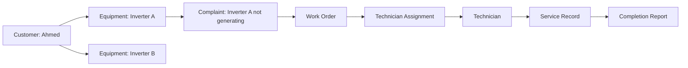

# FieldOps AI — Database Design and Data Modeling

**FieldOps AI: Autonomous Field-Service Coordination Platform**

This document designs the database that supports the FieldOps AI architecture. Almost every major feature depends on correctly structured data:

- A customer must be linked to their equipment.
- A complaint must be linked to the correct customer and equipment.
- A work order must preserve the original complaint.
- A technician assignment must be traceable.
- A repair must produce a verifiable service record.
- An AI workflow must be able to pause and resume without losing progress.

PostgreSQL is the primary database, and pgvector provides semantic search over technical manuals.

**Contents**

1. [What database design means](#1-what-database-design-means)
2. [Main database entities](#2-main-database-entities)
3. [Primary keys and foreign keys](#3-primary-keys-and-foreign-keys)
4. [Identity tables](#4-identity-tables)
5. [Equipment and complaint tables](#5-equipment-and-complaint-tables)
6. [Work-order and assignment tables](#6-work-order-and-assignment-tables)
7. [RAG knowledge tables](#7-rag-knowledge-tables)
8. [AI workflow tracking table](#8-ai-workflow-tracking-table)
9. [Complaint and work-order statuses](#9-complaint-and-work-order-statuses)
10. [PostgreSQL schema example](#10-postgresql-schema-example)
11. [SQLAlchemy](#11-how-sqlalchemy-fits-into-the-architecture)
12. [Database integrity and transaction safety](#12-database-integrity-and-transaction-safety)
13. [Database indexes](#13-database-indexes)
14. [Business data vs. AI workflow state](#14-business-data-vs-ai-workflow-state)
15. [Recommended folder structure](#15-recommended-folder-structure)
16. [Design decisions summary](#16-design-decisions-summary)

---

## 1. What database design means

Imagine a customer named Ahmed owns two solar inverters. He submits a complaint about one of them. FieldOps AI analyzes the complaint and creates a work order. A technician is assigned, visits the location, repairs the equipment and submits a completion report.

All of these relationships need to be preserved.



This is the purpose of relational database design: storing information in separate but connected tables rather than putting everything into one large table.

For example, a single table containing customer details, equipment details, complaint messages, technician details and repair information would create duplicated information and make updates difficult.

## 2. Main database entities

An entity is something about which the application needs to store information. For FieldOps AI, the database is organized into seven groups.

| Group | Tables | Purpose |
| --- | --- | --- |
| Identity | `users`, `customers`, `technicians` | User accounts and profiles |
| Equipment | `equipment` | Customer-owned equipment |
| Complaint management | `complaints`, `conversations`, `messages` | Incoming complaints and communication |
| Work management | `work_orders`, `technician_assignments` | Repair jobs and scheduling |
| Knowledge | `documents`, `document_chunks` | Manuals and searchable content |
| Maintenance | `service_records`, `completion_reports` | Repair history and verification |
| Workflow | `workflow_runs` | AI workflow monitoring |

The initial design has 14 tables, a reasonable size for this project. Not every advanced feature needs to be implemented on day one.

## 3. Primary keys and foreign keys

Two database concepts underpin the design.

### Primary key (PK)

A primary key uniquely identifies a row.

| id | name |
| --- | --- |
| 101 | Ahmed |
| 102 | Ali |
| 103 | Hassan |

Each user has a unique ID.

### Foreign key (FK)

A foreign key connects one table to another. For example, the `equipment` table contains `customer_id`.

| id | customer_id | model |
| --- | --- | --- |
| 201 | 101 | Inverter X |
| 202 | 101 | Inverter Y |
| 203 | 102 | Inverter Z |

This tells us:

- Ahmed owns equipment 201 and 202.
- Ali owns equipment 203.

The `customer_id` in the equipment table refers to a customer record. In FieldOps AI, foreign keys connect almost all the major tables.

## 4. Identity tables

### Table 1: `users`

Stores login accounts.

| Column | Type | Description |
| --- | --- | --- |
| `id` | UUID | Primary key |
| `full_name` | VARCHAR | User's name |
| `email` | VARCHAR | Unique email, nullable if not used |
| `phone` | VARCHAR | Contact number |
| `password_hash` | TEXT | Hashed password |
| `role` | VARCHAR | customer, technician or admin |
| `is_active` | BOOLEAN | Account status |
| `created_at` | TIMESTAMPTZ | Account creation time |

**Why separate users from customers and technicians?** A login account and a business profile represent different things. A user is an identity that can authenticate. A customer is a business profile that owns equipment. A technician is a profile containing skills and operational information.

### Table 2: `customers`

| Column | Type | Description |
| --- | --- | --- |
| `id` | UUID | Primary key |
| `user_id` | UUID | FK to users |
| `address` | TEXT | Customer address |
| `preferred_language` | VARCHAR | Communication preference |
| `created_at` | TIMESTAMPTZ | Creation time |

### Table 3: `technicians`

| Column | Type | Description |
| --- | --- | --- |
| `id` | UUID | Primary key |
| `user_id` | UUID | FK to users |
| `skills` | JSONB | Technician skills |
| `service_area` | TEXT | Operational service area |
| `is_available` | BOOLEAN | General availability |
| `created_at` | TIMESTAMPTZ | Creation time |

For example, a technician's `skills` could contain:

```json
{
  "equipment_types": ["solar_inverter", "solar_panel"],
  "certifications": ["solar_maintenance"],
  "experience_level": "intermediate"
}
```

JSONB is useful for flexible attributes, but not everything should go into JSON. Information that needs relationships, filtering, constraints or frequent querying should generally have proper columns or related tables.

## 5. Equipment and complaint tables

### Table 4: `equipment`

Every registered piece of equipment belongs to a customer.

| Column | Type | Description |
| --- | --- | --- |
| `id` | UUID | Primary key |
| `customer_id` | UUID | FK to customers |
| `manufacturer` | VARCHAR | Equipment manufacturer |
| `model` | VARCHAR | Model number |
| `serial_number` | VARCHAR | Serial number |
| `equipment_type` | VARCHAR | Inverter, panel, battery, etc. |
| `installation_date` | DATE | Installation date |
| `created_at` | TIMESTAMPTZ | Registration time |

Example:

| id | customer_id | manufacturer | model |
| --- | --- | --- | --- |
| EQ-001 | CU-001 | Manufacturer A | INV-5000 |
| EQ-002 | CU-001 | Manufacturer B | INV-3000 |

In production, UUIDs should be used rather than manually assigned IDs like `EQ-001`. These labels are only for explanation.

### Table 5: `complaints`

One of the most important tables. It stores the original customer complaint and its processing status.

| Column | Type | Description |
| --- | --- | --- |
| `id` | UUID | Primary key |
| `customer_id` | UUID | FK to customers |
| `equipment_id` | UUID | FK to equipment, nullable initially |
| `description` | TEXT | Original complaint |
| `reported_symptoms` | JSONB | Extracted symptoms |
| `reported_error_code` | VARCHAR | Reported error code |
| `channel` | VARCHAR | web or whatsapp |
| `status` | VARCHAR | Current complaint status |
| `priority` | VARCHAR | Normal, high, urgent |
| `created_at` | TIMESTAMPTZ | Submission time |
| `updated_at` | TIMESTAMPTZ | Last update |

**Why can `equipment_id` initially be nullable?** A customer may submit a complaint without knowing which equipment is affected. The AI can ask for clarification, and the equipment can be associated later.

> The original complaint should remain available even after AI processing. Never replace the customer's original words with an AI-generated summary.

### Table 6: `conversations`

A conversation connects messages to a complaint.

| Column | Type | Description |
| --- | --- | --- |
| `id` | UUID | Primary key |
| `complaint_id` | UUID | FK to complaints |
| `channel` | VARCHAR | web or whatsapp |
| `external_conversation_id` | VARCHAR | External channel identifier |
| `created_at` | TIMESTAMPTZ | Creation time |

### Table 7: `messages`

Stores individual messages in a conversation.

| Column | Type | Description |
| --- | --- | --- |
| `id` | UUID | Primary key |
| `conversation_id` | UUID | FK to conversations |
| `sender_type` | VARCHAR | customer, assistant or staff |
| `content` | TEXT | Message content |
| `media_path` | TEXT | Optional file location |
| `media_type` | VARCHAR | image, audio or document |
| `external_message_id` | VARCHAR | WhatsApp message ID, when applicable |
| `created_at` | TIMESTAMPTZ | Message time |

**Why separate conversations and messages?** One complaint can involve many messages. For example:

1. Customer reports an inverter issue.
2. AI asks for the model number.
3. Customer provides the model number.
4. AI asks for the displayed error code.
5. Customer sends a photograph.

All five messages belong to the same conversation.

> **Important:** store external message IDs with a uniqueness constraint where available. This prevents duplicate WhatsApp webhook deliveries from creating duplicate messages.

## 6. Work-order and assignment tables

This is the operational core of FieldOps AI.

### Table 8: `work_orders`

A work order represents an official repair job.

| Column | Type | Description |
| --- | --- | --- |
| `id` | UUID | Primary key |
| `complaint_id` | UUID | FK to complaints |
| `equipment_id` | UUID | FK to equipment |
| `title` | VARCHAR | Job title |
| `description` | TEXT | Work description |
| `diagnostic_checklist` | JSONB | Generated checklist |
| `priority` | VARCHAR | Job priority |
| `status` | VARCHAR | Current job status |
| `created_at` | TIMESTAMPTZ | Creation time |
| `updated_at` | TIMESTAMPTZ | Last update |

Example of a diagnostic checklist (illustrative data, not a real inverter repair procedure):

```json
{
  "items": [
    {
      "task": "Verify the displayed error code",
      "source_document": "INV-5000-manual",
      "source_page": 42
    },
    {
      "task": "Inspect the equipment according to the approved service procedure",
      "source_document": "INV-5000-manual",
      "source_page": 45
    }
  ]
}
```

The source document and page references matter because a technician should be able to check where a technical recommendation came from.

### Table 9: `technician_assignments`

Only storing `technician_id` directly in the work-order table is not enough; a separate assignment table is used.

| Column | Type | Description |
| --- | --- | --- |
| `id` | UUID | Primary key |
| `work_order_id` | UUID | FK to work_orders |
| `technician_id` | UUID | FK to technicians |
| `assigned_at` | TIMESTAMPTZ | Assignment time |
| `accepted_at` | TIMESTAMPTZ | Acceptance time |
| `rejected_at` | TIMESTAMPTZ | Rejection time |
| `assignment_status` | VARCHAR | Current assignment state |

**Why?** Imagine:

- Work order 001 is assigned to Technician A.
- Technician A rejects it.
- The system assigns it to Technician B.
- Technician B accepts it.

If `technician_id` is simply overwritten, the assignment history is lost. With a separate table, both assignments are preserved, which gives the admin a complete operational history.

### Table 10: `service_records`

Stores the actual maintenance history.

| Column | Type | Description |
| --- | --- | --- |
| `id` | UUID | Primary key |
| `equipment_id` | UUID | FK to equipment |
| `work_order_id` | UUID | FK to work_orders |
| `technician_id` | UUID | FK to technicians |
| `findings` | TEXT | Technician's observations |
| `work_performed` | TEXT | Work carried out |
| `parts_used` | JSONB | Parts and quantities |
| `recorded_at` | TIMESTAMPTZ | Record time |

A service record is valuable because future complaints can use previous repair information. For example, if the same inverter repeatedly reports a particular fault, the AI can retrieve its previous service history before preparing the next work order.

### Table 11: `completion_reports`

| Column | Type | Description |
| --- | --- | --- |
| `id` | UUID | Primary key |
| `work_order_id` | UUID | FK to work_orders |
| `summary` | TEXT | Completion summary |
| `evidence_status` | VARCHAR | pending, verified or rejected |
| `verification_notes` | TEXT | Validation information |
| `submitted_at` | TIMESTAMPTZ | Submission time |
| `verified_at` | TIMESTAMPTZ | Verification time |

The LLM can generate the report summary from technician notes. However, the backend must check the required completion evidence before allowing the work order to close.

## 7. RAG knowledge tables

The database structure for manufacturer manuals.

### Table 12: `documents`

Stores information about uploaded manuals.

| Column | Type | Description |
| --- | --- | --- |
| `id` | UUID | Primary key |
| `manufacturer` | VARCHAR | Manufacturer |
| `model` | VARCHAR | Equipment model |
| `document_name` | VARCHAR | Manual name |
| `version` | VARCHAR | Manual version |
| `file_path` | TEXT | Storage location |
| `is_active` | BOOLEAN | Whether the manual is approved for retrieval |
| `created_at` | TIMESTAMPTZ | Upload time |

### Table 13: `document_chunks`

Stores the smaller text sections extracted from manuals.

| Column | Type | Description |
| --- | --- | --- |
| `id` | UUID | Primary key |
| `document_id` | UUID | FK to documents |
| `chunk_index` | INTEGER | Position in document |
| `content` | TEXT | Extracted text |
| `page_number` | INTEGER | Original PDF page |
| `embedding` | VECTOR | Embedding representation |
| `metadata` | JSONB | Additional document metadata |

Example:

```
Document:
INV-5000 Technical Manual

Chunk 1:
Introduction and equipment specifications

Chunk 2:
Installation requirements

Chunk 3:
Error codes and troubleshooting

Chunk 4:
Maintenance procedures
```

Each chunk receives an embedding from an embedding model. pgvector stores these embeddings and allows similarity search.

> **Important:** the vector dimension depends on the embedding model selected. Don't assume all embedding models produce vectors of the same size.

Document version information should also be stored. If a manufacturer publishes a newer manual, the system needs to know which version was used to generate a checklist.

## 8. AI workflow tracking table

### Table 14: `workflow_runs`

Tracks the execution of the AI workflow.

| Column | Type | Description |
| --- | --- | --- |
| `id` | UUID | Primary key |
| `complaint_id` | UUID | FK to complaints |
| `status` | VARCHAR | running, paused, completed, failed |
| `current_step` | VARCHAR | Current workflow stage |
| `started_at` | TIMESTAMPTZ | Start time |
| `finished_at` | TIMESTAMPTZ | End time |
| `error_message` | TEXT | Error information, if any |

**Why is this table needed if LangGraph already manages state?** These are two different responsibilities:

- **LangGraph checkpoint storage** preserves the detailed state needed to resume a workflow.
- **`workflow_runs`** gives the application a simple, queryable operational record of workflow execution.

For example, the admin dashboard can query this table to show complaints whose AI processing has failed.

LangGraph's supported PostgreSQL checkpoint integration should be used for the actual checkpoints. Don't invent a custom checkpoint format or manually store the entire LangGraph state in `workflow_runs`.

## 9. Complaint and work-order statuses

Status management is a critical part of the database design. A complaint and a work order are not the same thing, so they have separate statuses.

### Complaint statuses

| Status | Meaning |
| --- | --- |
| `received` | Complaint has arrived |
| `analyzing` | AI is analyzing the complaint |
| `awaiting_customer` | Missing information is required |
| `ready_for_work_order` | Complaint has enough information |
| `converted` | Work order has been created |
| `escalated` | Requires human intervention |
| `closed` | Complaint process has ended |

### Work-order statuses

| Status | Meaning |
| --- | --- |
| `draft` | Work order is being prepared |
| `validated` | Backend has validated it |
| `awaiting_assignment` | No technician has been assigned yet |
| `assigned` | Technician has been assigned |
| `accepted` | Technician accepted |
| `in_progress` | Repair has started |
| `awaiting_parts` | Parts are needed |
| `pending_verification` | Completion evidence is being checked |
| `completed` | Required completion conditions are satisfied |
| `cancelled` | Job has been cancelled |
| `escalated` | Requires further intervention |

### Assignment statuses

| Status | Meaning |
| --- | --- |
| `offered` | Assignment sent to technician |
| `accepted` | Technician accepted |
| `rejected` | Technician rejected |
| `withdrawn` | Assignment withdrawn |
| `expired` | Technician did not respond within the allowed period |

### Why this matters

Suppose a technician rejects an assignment. The assignment status changes to `rejected`, but the work order should not become `completed` or `cancelled`. Instead, the scheduling service can find another eligible technician and create a new assignment. This is why separate status fields are important.

### Enforce valid transitions

Arbitrary status updates should not be allowed. For example:

```
assigned -> accepted -> in_progress
                           |
                           v
                     awaiting_parts
                           |
                           v
                       in_progress
                           |
                           v
                 pending_verification
                           |
                           v
                       completed
```

A technician should not be able to directly change:

```
assigned -> completed
```

The backend should reject that transition. Transition rules belong in a dedicated work-order service, with additional database constraints enforced where appropriate.

## 10. PostgreSQL schema example

The following is a representative starting point for the core tables, not the entire database migration.

```sql
CREATE EXTENSION IF NOT EXISTS pgcrypto;

CREATE TABLE users (
    id UUID PRIMARY KEY DEFAULT gen_random_uuid(),
    full_name VARCHAR(150) NOT NULL,
    email VARCHAR(255) UNIQUE,
    phone VARCHAR(30) UNIQUE,
    password_hash TEXT NOT NULL,
    role VARCHAR(20) NOT NULL
        CHECK (role IN ('customer', 'technician', 'admin')),
    is_active BOOLEAN NOT NULL DEFAULT TRUE,
    created_at TIMESTAMPTZ NOT NULL DEFAULT NOW()
);

CREATE TABLE customers (
    id UUID PRIMARY KEY DEFAULT gen_random_uuid(),
    user_id UUID NOT NULL UNIQUE REFERENCES users(id),
    address TEXT,
    preferred_language VARCHAR(30),
    created_at TIMESTAMPTZ NOT NULL DEFAULT NOW()
);

CREATE TABLE equipment (
    id UUID PRIMARY KEY DEFAULT gen_random_uuid(),
    customer_id UUID NOT NULL REFERENCES customers(id),
    manufacturer VARCHAR(150) NOT NULL,
    model VARCHAR(150) NOT NULL,
    serial_number VARCHAR(150),
    equipment_type VARCHAR(80) NOT NULL,
    installation_date DATE,
    created_at TIMESTAMPTZ NOT NULL DEFAULT NOW(),
    UNIQUE (manufacturer, serial_number)
);

CREATE TABLE complaints (
    id UUID PRIMARY KEY DEFAULT gen_random_uuid(),
    customer_id UUID NOT NULL REFERENCES customers(id),
    equipment_id UUID REFERENCES equipment(id),
    description TEXT NOT NULL,
    reported_symptoms JSONB NOT NULL DEFAULT '[]',
    reported_error_code VARCHAR(100),
    channel VARCHAR(20) NOT NULL
        CHECK (channel IN ('web', 'whatsapp')),
    status VARCHAR(40) NOT NULL DEFAULT 'received',
    priority VARCHAR(20) NOT NULL DEFAULT 'normal',
    created_at TIMESTAMPTZ NOT NULL DEFAULT NOW(),
    updated_at TIMESTAMPTZ NOT NULL DEFAULT NOW()
);

CREATE TABLE work_orders (
    id UUID PRIMARY KEY DEFAULT gen_random_uuid(),
    complaint_id UUID NOT NULL UNIQUE REFERENCES complaints(id),
    equipment_id UUID NOT NULL REFERENCES equipment(id),
    title VARCHAR(255) NOT NULL,
    description TEXT NOT NULL,
    diagnostic_checklist JSONB NOT NULL DEFAULT '[]',
    priority VARCHAR(20) NOT NULL DEFAULT 'normal',
    status VARCHAR(40) NOT NULL DEFAULT 'draft',
    created_at TIMESTAMPTZ NOT NULL DEFAULT NOW(),
    updated_at TIMESTAMPTZ NOT NULL DEFAULT NOW()
);

CREATE TABLE technician_assignments (
    id UUID PRIMARY KEY DEFAULT gen_random_uuid(),
    work_order_id UUID NOT NULL REFERENCES work_orders(id),
    technician_id UUID NOT NULL REFERENCES technicians(id),
    assignment_status VARCHAR(30) NOT NULL DEFAULT 'offered',
    assigned_at TIMESTAMPTZ NOT NULL DEFAULT NOW(),
    accepted_at TIMESTAMPTZ,
    rejected_at TIMESTAMPTZ
);
```

Two details to note:

- This SQL assumes the `technicians` table has already been created, so the assignment table must be created after it. In a real migration, tables are defined in foreign-key dependency order.
- `UNIQUE (manufacturer, serial_number)` is a simplified constraint. If serial numbers can be missing or reused by different manufacturers, the exact uniqueness rule should be reviewed for the chosen equipment domain.

### Why use UUIDs?

- They provide globally unique identifiers.
- They are harder to guess than sequential IDs.
- They work well when records are created by different application components.

They are not a replacement for authorization. A UUID does not make an API secure by itself.

## 11. How SQLAlchemy fits into the architecture

FastAPI code is written in Python, but PostgreSQL understands SQL. SQLAlchemy acts as the bridge between Python objects and database tables. Instead of writing raw SQL every time a customer is created, a Python model is defined:

```python
import uuid

from sqlalchemy import String, Boolean
from sqlalchemy.orm import Mapped, mapped_column
from sqlalchemy.dialects.postgresql import UUID


class User(Base):
    __tablename__ = "users"

    id: Mapped[uuid.UUID] = mapped_column(
        UUID(as_uuid=True),
        primary_key=True,
        default=uuid.uuid4
    )

    full_name: Mapped[str] = mapped_column(
        String(150),
        nullable=False
    )

    email: Mapped[str | None] = mapped_column(
        String(255),
        unique=True,
        nullable=True
    )

    role: Mapped[str] = mapped_column(
        String(20),
        nullable=False
    )

    is_active: Mapped[bool] = mapped_column(
        Boolean,
        default=True
    )
```

This is a simplified model. The actual implementation should also include relationships, constraints, timestamps and consistent UUID generation.

The development process:

1. Define SQLAlchemy models.
2. Generate database migrations using Alembic.
3. Apply migrations to PostgreSQL.
4. Use SQLAlchemy sessions to create, retrieve and update records.
5. Validate incoming and outgoing API data with Pydantic schemas.

| Technology | Responsibility |
| --- | --- |
| PostgreSQL | Stores data |
| SQLAlchemy | Communicates with the database |
| Alembic | Manages database schema changes |
| Pydantic | Validates application data |

Pydantic schemas should not be confused with database models; they solve different problems.

## 12. Database integrity and transaction safety

This is where a good database design becomes a reliable application.

Imagine two background workers try to assign the same technician to two overlapping jobs. Without proper protection, both workers might see the technician as available and assign them simultaneously. This is called a **race condition**.

### Preventing it

The scheduling service should:

1. Start a database transaction.
2. Lock the relevant technician or availability record.
3. Check existing assignments and working hours.
4. Confirm that the proposed time slot is available.
5. Create the assignment.
6. Commit the transaction.

If the availability check fails, roll back the transaction and try another technician. In PostgreSQL, `SELECT ... FOR UPDATE` can help protect records during this operation. More advanced scheduling can use database exclusion constraints for overlapping time ranges.

### Other integrity rules

The database and backend should enforce rules such as:

- A complaint must belong to a valid customer.
- Equipment must belong to the customer associated with the complaint.
- A work order must reference a valid complaint.
- A technician assignment must reference a valid technician.
- Duplicate webhook events must not create duplicate messages.
- A completed work order must satisfy the required completion conditions.
- A customer must not access another customer's records.

> The `customer_id` or `technician_id` supplied by the frontend must not be trusted. The user's identity should be derived from the authenticated session and ownership verified on the backend.

## 13. Database indexes

As FieldOps AI grows, it will need to retrieve records quickly. Consider these queries:

- Show all complaints belonging to a customer.
- Find all equipment owned by a customer.
- Find work orders assigned to a technician.
- Show all pending complaints.
- Retrieve the latest service records for equipment.

Indexes help PostgreSQL locate matching records without scanning an entire table.

```sql
CREATE INDEX idx_equipment_customer
ON equipment(customer_id);

CREATE INDEX idx_complaints_customer
ON complaints(customer_id);

CREATE INDEX idx_complaints_status
ON complaints(status);

CREATE INDEX idx_work_orders_status
ON work_orders(status);

CREATE INDEX idx_assignments_technician
ON technician_assignments(technician_id);

CREATE INDEX idx_service_records_equipment
ON service_records(equipment_id);
```

For pgvector, choose an appropriate vector index, such as HNSW, after considering the embedding model, dataset size and retrieval requirements.

Indexes should not be added blindly. They improve certain reads but also consume storage and add overhead to writes, so they should be added based on actual query patterns.

## 14. Business data vs. AI workflow state

This is one of the most important concepts in the entire project. There are two types of state.

**1. Business state — PostgreSQL application tables**

- Complaint status: `awaiting_customer`
- Work order status: `assigned`
- Technician assignment: `accepted`
- Completion report: `pending_verification`

**2. AI workflow state — LangGraph checkpoints**

- Extracted complaint information
- Missing information
- Current graph node
- Retrieved manual context
- Clarification conversation state
- Workflow execution progress

These states are related, but they are not interchangeable. For example, a LangGraph checkpoint might show that the AI has finished generating a checklist. That does not automatically mean an official work order exists. The backend must successfully validate and save the work order before the application reports that it has been created.

> This separation prevents AI execution state from becoming the authority for business operations.

## 15. Recommended folder structure

As the project grows, database-related code can be organized like this:

```
backend/
│
├── app/
│   ├── models/
│   │   ├── user.py
│   │   ├── customer.py
│   │   ├── technician.py
│   │   ├── equipment.py
│   │   ├── complaint.py
│   │   ├── conversation.py
│   │   ├── work_order.py
│   │   ├── assignment.py
│   │   ├── document.py
│   │   └── service_record.py
│   │
│   ├── schemas/
│   │   ├── complaint.py
│   │   ├── equipment.py
│   │   └── work_order.py
│   │
│   ├── repositories/
│   │   ├── complaint_repository.py
│   │   ├── equipment_repository.py
│   │   └── work_order_repository.py
│   │
│   ├── services/
│   │   ├── complaint_service.py
│   │   ├── work_order_service.py
│   │   └── assignment_service.py
│   │
│   └── database/
│       ├── connection.py
│       └── base.py
│
└── alembic/
    └── versions/
```

- **Models** describe database tables.
- **Repositories** handle data-access operations.
- **Services** implement application and business rules.
- **Schemas** validate API data.

This is a clean separation that makes the project easier to maintain.

## 16. Design decisions summary

| Design decision | Choice |
| --- | --- |
| Primary database | PostgreSQL |
| Primary identifiers | UUID |
| Database access | SQLAlchemy |
| Schema migrations | Alembic |
| API validation | Pydantic |
| Flexible structured attributes | JSONB, where appropriate |
| Semantic manual search | pgvector |
| Uploaded media | Object storage |
| AI workflow persistence | LangGraph PostgreSQL checkpointing |
| Business record authority | PostgreSQL application tables |
| Assignment safety | Backend validation and transactions |
