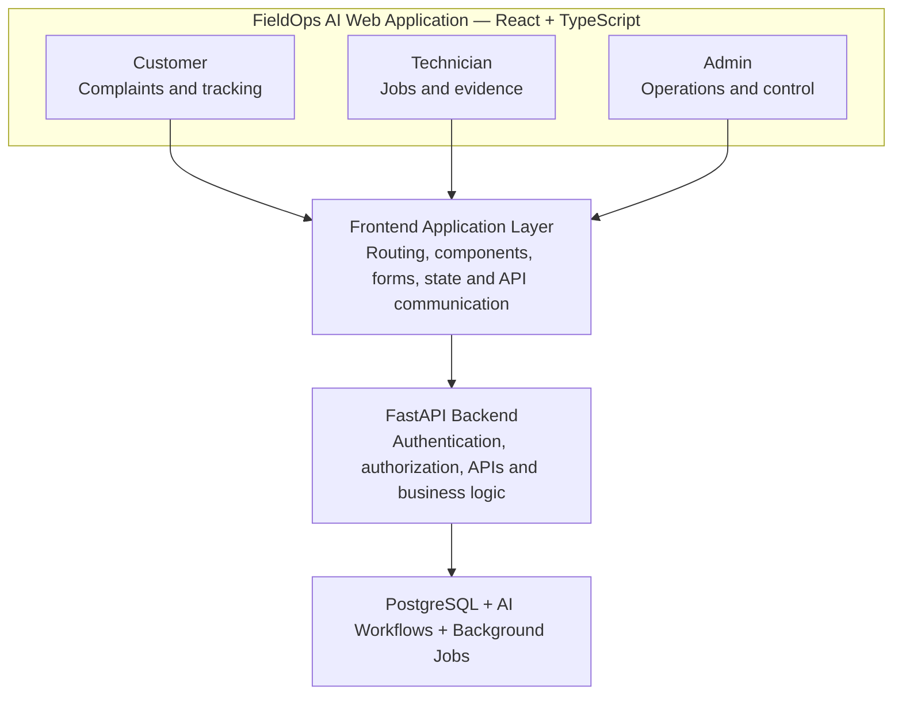

# FieldOps AI — Frontend Engineering and User Experience

**FieldOps AI: Autonomous Field-Service Coordination Platform**

This document designs the part of FieldOps AI that people actually interact with: the web application. The backend (FastAPI, PostgreSQL, authentication, background jobs and LangGraph integration) is designed separately.

The platform has three main user roles:

1. **Customers** — submit complaints and track repairs.
2. **Technicians** — receive jobs, perform maintenance, and submit evidence.
3. **Administrators/dispatchers** — monitor operations, manage technicians, and oversee work orders.

The frontend must give each role the right information and actions without exposing features they aren't authorized to use.

Recommended stack:

- React
- TypeScript
- Vite
- Tailwind CSS
- React Router
- TanStack Query
- React Hook Form
- Zod
- Axios or the native Fetch API

A single React application with role-specific dashboards is used, rather than three completely separate frontend applications.

**Contents**

1. [Understanding the frontend architecture](#1-understanding-the-frontend-architecture)
2. [Why React and TypeScript?](#2-why-react-and-typescript)
3. [Three dashboards, one application](#3-three-dashboards-one-application)
4. [React project structure](#4-react-project-structure)
5. [Routing and role-based navigation](#5-routing-and-role-based-navigation)
6. [Connecting React with FastAPI](#6-connecting-react-with-fastapi)
7. [TanStack Query — managing server data](#7-tanstack-query--managing-server-data)
8. [Real-time updates](#8-real-time-updates)
9. [Chat interface and multimodal uploads](#9-chat-interface-and-multimodal-uploads)
10. [UI design principles](#10-ui-design-principles-for-fieldops-ai)
11. [Frontend testing](#11-frontend-testing)
12. [Implementation sequence](#12-recommended-frontend-implementation-sequence)
13. [Final frontend technology stack](#13-final-frontend-technology-stack)

---

## 1. Understanding the frontend architecture



The frontend does not communicate directly with PostgreSQL or call LangGraph to change business records. Instead:

- React displays information and collects user input.
- FastAPI validates requests and checks permissions.
- Backend services perform business operations.
- PostgreSQL stores the resulting records.
- AI workflows process complaints and provide updates.
- React retrieves and displays those updates.

This separation is important. A user should never be able to bypass backend security simply by modifying frontend JavaScript.

## 2. Why React and TypeScript?

### React

React is a JavaScript library for building interactive user interfaces. FieldOps AI will contain many reusable interface elements:

- Complaint cards.
- Equipment information panels.
- Technician profiles.
- Work-order tables.
- Chat interfaces.
- Status indicators.
- File upload components.
- Dashboards.

Instead of creating each interface independently, reusable React components can be built. For example, a single `WorkOrderCard` component can display a work order in both the technician and administrator dashboards, while showing different available actions depending on the user's permissions.

### TypeScript

TypeScript adds static typing to JavaScript. Consider a work order:

```typescript
type WorkOrderStatus =
  | "DRAFT"
  | "VALIDATED"
  | "ASSIGNED"
  | "ACCEPTED"
  | "IN_PROGRESS"
  | "AWAITING_PARTS"
  | "COMPLETION_REVIEW"
  | "COMPLETED"
  | "ESCALATED"
  | "CANCELLED";

interface WorkOrder {
  id: string;
  complaint_id: string;
  equipment_id: string;
  status: WorkOrderStatus;
  priority: "LOW" | "MEDIUM" | "HIGH" | "URGENT";
  created_at: string;
}
```

TypeScript can now detect many mistakes during development. For example, accidentally assigning `"FINISHED"` to `WorkOrderStatus` produces a type error because it isn't an allowed value.

**Recommendation:** use TypeScript from the beginning. This project has enough API responses, statuses, roles and structured data that plain JavaScript would become harder to maintain.

## 3. Three dashboards, one application

### A. Customer dashboard

The customer needs a simple experience. They should not need to understand AI agents, RAG, LangGraph or technical workflows. They want answers to practical questions:

- Can I report a problem?
- Has the company received my complaint?
- Does the system need more information?
- Has a technician been assigned?
- When will the technician arrive?
- Is the repair complete?

Recommended customer dashboard sections:

| Section | What it displays |
| --- | --- |
| Overview | Total complaints and active jobs |
| My Equipment | Registered solar systems and inverters |
| Submit Complaint | Text, image and audio input |
| My Complaints | Complaint history and status |
| Work Orders | Assigned technician and job progress |
| Messages | Communication with FieldOps AI and company staff |
| Reports | Completed maintenance reports |

#### Complaint submission experience

This is one of the most important screens in the entire application. The customer should be able to:

1. Select registered equipment, if known.
2. Describe the problem in ordinary language.
3. Upload photographs.
4. Record or upload a voice message.
5. Submit the complaint.

For example:

```
Report a Problem

Which equipment has a problem?
[ Select your inverter ]

Describe what happened:
[ My inverter stopped generating electricity... ]

Attach photographs:
[ Upload Images ]

Voice description:
[ Record Audio ]

[ Submit Complaint ]
```

The customer should not be forced to complete a long technical form. The AI workflow exists partly to collect missing technical information through conversation.

#### AI clarification chat

After submitting a complaint, the customer may see a chat interface. Illustrative conversation (actual responses come from the backend workflow):

> **FieldOps AI — Complaint investigation**
>
> **AI:** Your complaint has been received. I can see that your inverter is reporting a problem. Could you share the model number shown on its label?
>
> **Customer:** It says Solis S6 on the label.
>
> **AI:** Thank you. I've added that equipment information to your complaint. I'm checking the relevant technical documentation now.
>
> *[ Type your response... ]*

The chat interface should support:

- Text messages.
- Image attachments.
- Audio attachments.
- Message timestamps.
- Upload progress.
- Processing indicators.
- Error and retry states.
- Complaint status updates.

One important detail: the frontend should not pretend the AI is processing when the backend has not confirmed that processing has started. It should display actual backend states, such as `RECEIVED`, `PROCESSING` or `NEEDS_INFORMATION`.

### B. Technician dashboard

Technicians need a different experience. Their main goal is to understand their assigned jobs and complete them efficiently. Recommended sections:

| Section | What it displays |
| --- | --- |
| Overview | Assigned, active and completed jobs |
| My Jobs | List of assigned work orders |
| Job Details | Equipment, customer, symptoms and checklist |
| Technical References | Relevant manual excerpts and instructions |
| Job Updates | Accept, start, pause or request assistance |
| Completion | Repair notes, photographs and test results |
| History | Previously completed work |

#### Technician job detail screen

A work order should provide enough information for a technician to understand the job. Example:

```
WORK ORDER: WO-2026-0012

Equipment:
Solis S6 Inverter

Customer:
Ahmed

Reported Symptoms:
Inverter stopped generating electricity.
Customer reports a red indicator.

Priority:
HIGH

AI-Prepared Diagnostic Checklist:
1. Confirm inverter model and serial number.
2. Review the reported error indicator.
3. Consult the approved manufacturer documentation.
4. Perform approved inspection procedures.

Technical Evidence:
Manual: Solis S6 Installation Manual
Reference: Relevant retrieved section

Actions:
[ Accept Job ]
[ Request Assistance ]
```

The diagnostic checklist is a preparation aid, not an authorization to perform dangerous procedures. For electrical work, the technician must follow applicable safety procedures, qualifications and manufacturer instructions. The interface should clearly distinguish AI-generated suggestions from approved company procedures.

#### Job completion interface

When a technician completes a job, the application should request:

- Work performed.
- Final observations.
- Parts replaced, if any.
- Photographs or other evidence.
- Relevant test results.
- Whether the equipment was returned to service.

The backend then validates the submission. If required evidence is missing, the job can remain in `COMPLETION_REVIEW` instead of automatically becoming `COMPLETED`.

### C. Administrator / dispatcher dashboard

This dashboard is for managing the whole operation. Recommended sections:

| Section | What it displays |
| --- | --- |
| Overview | Total complaints, active jobs and overdue work |
| Complaints | All company complaints |
| Work Orders | All work orders and their statuses |
| Technicians | Profiles, skills and availability |
| Scheduling | Technician assignments |
| Equipment | Customer equipment records |
| Knowledge Base | Uploaded manuals and document status |
| Reports | Operational performance and job history |
| Audit Logs | Important system and user actions |

The administrator should be able to inspect the AI's work:

- What information did the customer provide?
- Which equipment did the system identify?
- Which manual sections were retrieved?
- What did the AI recommend?
- What was validated by the backend?
- Why was a case escalated?

This is important for transparency and debugging. A dashboard that only displays attractive charts should not be built; it must help staff actually resolve operational problems.

## 4. React project structure

The frontend should be organized by features rather than putting every component into one large folder. Example:

```
frontend/
│
├── src/
│   ├── app/
│   │   ├── App.tsx
│   │   ├── router.tsx
│   │   └── providers.tsx
│   │
│   ├── components/
│   │   ├── ui/
│   │   ├── layout/
│   │   └── common/
│   │
│   ├── features/
│   │   ├── auth/
│   │   ├── customer/
│   │   ├── complaints/
│   │   ├── chat/
│   │   ├── equipment/
│   │   ├── work-orders/
│   │   ├── technicians/
│   │   ├── scheduling/
│   │   └── reports/
│   │
│   ├── hooks/
│   ├── lib/
│   │   ├── api-client.ts
│   │   └── utils.ts
│   │
│   ├── types/
│   ├── styles/
│   └── main.tsx
│
├── public/
├── package.json
└── tsconfig.json
```

The `features/` directory is especially useful. For example:

```
features/
└── complaints/
    ├── components/
    │   ├── ComplaintForm.tsx
    │   ├── ComplaintCard.tsx
    │   └── ComplaintStatus.tsx
    │
    ├── pages/
    │   ├── ComplaintListPage.tsx
    │   └── ComplaintDetailsPage.tsx
    │
    ├── hooks/
    │   └── useComplaints.ts
    │
    ├── api/
    │   └── complaints-api.ts
    │
    └── types.ts
```

This keeps complaint-related code together. It also makes it easier to work on different features without creating a tightly coupled frontend.

## 5. Routing and role-based navigation

Different roles need different pages. React Router is used for frontend navigation. An example route structure:

```
/login

/customer
/customer/equipment
/customer/complaints
/customer/complaints/new
/customer/complaints/:id
/customer/work-orders

/technician
/technician/jobs
/technician/jobs/:id
/technician/history

/admin
/admin/complaints
/admin/work-orders
/admin/technicians
/admin/scheduling
/admin/equipment
/admin/reports
/admin/audit-logs
```

After login:

- Customer goes to `/customer`.
- Technician goes to `/technician`.
- Admin goes to `/admin`.

A conceptual protected route:

```tsx
function ProtectedRoute({
  allowedRoles,
  children,
}: {
  allowedRoles: string[];
  children: React.ReactNode;
}) {
  const { user, isLoading } = useAuth();

  if (isLoading) {
    return <LoadingScreen />;
  }

  if (!user) {
    return <Navigate to="/login" />;
  }

  if (!allowedRoles.includes(user.role)) {
    return <Navigate to="/unauthorized" />;
  }

  return children;
}
```

This improves the user experience, but:

> Frontend route protection is not security by itself. A user can modify browser requests or call APIs directly. FastAPI must enforce the same permissions independently.

## 6. Connecting React with FastAPI

Suppose the customer submits a complaint. The frontend calls:

```
POST http://localhost:8000/api/v1/complaints
```

A simple API client:

```typescript
const API_BASE_URL = "http://localhost:8000/api/v1";

export async function createComplaint(data: {
  description: string;
  equipment_id?: string;
}) {
  const response = await fetch(
    `${API_BASE_URL}/complaints`,
    {
      method: "POST",
      headers: {
        "Content-Type": "application/json",
      },
      credentials: "include",
      body: JSON.stringify(data),
    }
  );

  if (!response.ok) {
    throw new Error("Could not submit complaint");
  }

  return response.json();
}
```

This example assumes cookie-based authentication. If bearer tokens are chosen instead, the API client must attach the access token appropriately. For a browser application, secure, HttpOnly cookies are often preferable to storing long-lived tokens in local storage. In production, CORS must be configured correctly and HTTPS used.

### Handling API loading and errors

A frontend should not simply send a request and assume it succeeded. It should represent at least four states:

| State | What the user sees |
| --- | --- |
| Idle | Complaint form |
| Loading | Submitting complaint |
| Success | Complaint received |
| Error | Submission failed, with retry option |

Example:

```tsx
const [loading, setLoading] = useState(false);
const [error, setError] = useState<string | null>(null);

async function handleSubmit() {
  setLoading(true);
  setError(null);

  try {
    await createComplaint({
      description,
    });

    // Show confirmation or navigate to complaint details.
  } catch {
    setError("Unable to submit your complaint.");
  } finally {
    setLoading(false);
  }
}
```

For a larger application, API state and caching should be handled in TanStack Query rather than manually managing every request with component-level state.

## 7. TanStack Query — managing server data

TanStack Query is useful because FieldOps AI constantly retrieves and updates information from FastAPI, for example:

- Complaint lists.
- Work-order details.
- Technician availability.
- Equipment records.
- Customer messages.

Consider a complaint list:

```tsx
import { useQuery } from "@tanstack/react-query";

function useComplaints() {
  return useQuery({
    queryKey: ["complaints"],
    queryFn: async () => {
      const response = await fetch(
        "/api/v1/complaints",
        { credentials: "include" }
      );

      if (!response.ok) {
        throw new Error("Failed to load complaints");
      }

      return response.json();
    },
  });
}
```

Then in a component:

```tsx
function ComplaintList() {
  const { data, isPending, isError } = useComplaints();

  if (isPending) {
    return <p>Loading complaints...</p>;
  }

  if (isError) {
    return <p>Could not load complaints.</p>;
  }

  return (
    <div>
      {data.map((complaint: any) => (
        <div key={complaint.id}>
          {complaint.description}
        </div>
      ))}
    </div>
  );
}
```

This example is simplified; the real implementation should use a typed API response rather than `any`.

TanStack Query provides caching, request deduplication, refetching and mutation support. This is useful when multiple screens depend on the same server data.

### Server state vs. frontend state

These concepts should not be mixed.

| Server state | Local UI state |
| --- | --- |
| Complaint records | Whether a modal is open |
| Work-order details | Selected tab |
| Technician availability | Form input before submission |
| Message history | Current input field value |
| Equipment information | Expanded sidebar |

TanStack Query is primarily for server state. React state is enough for many small UI interactions.

## 8. Real-time updates

Users should see work-order changes without repeatedly refreshing the page. Consider this scenario:

1. Admin assigns a technician.
2. Technician accepts the job.
3. Technician starts work.
4. Technician completes the repair.
5. Customer sees the updated status.

There are three common approaches.

| Method | How it works | Trade-off |
| --- | --- | --- |
| Polling | Frontend requests updates periodically | Simple but creates repeated requests |
| Server-Sent Events (SSE) | Server streams updates to browser | Good for one-way updates |
| WebSockets | Persistent two-way connection | More flexible, but more complex |

For the FYP, start with TanStack Query polling. For example, refresh a work-order detail every 10 seconds while the page is active:

```typescript
useQuery({
  queryKey: ["work-order", workOrderId],
  queryFn: () => getWorkOrder(workOrderId),
  refetchInterval: 10_000,
});
```

Later, if the experience requires faster updates, WebSockets or SSE can be introduced. Real-time infrastructure should not be introduced before it is needed.

## 9. Chat interface and multimodal uploads

The customer chat is a key part of FieldOps AI because it supports clarification and complaint investigation. The chat should be split into separate components:

```
Chat/
├── ChatWindow.tsx
├── MessageList.tsx
├── MessageBubble.tsx
├── MessageInput.tsx
├── ImageUploader.tsx
├── AudioRecorder.tsx
├── AttachmentPreview.tsx
└── TypingIndicator.tsx
```

### Message data structure

A message should have a clear type and status.

```typescript
type MessageType =
  | "TEXT"
  | "IMAGE"
  | "AUDIO"
  | "SYSTEM";

interface ChatMessage {
  id: string;
  complaint_id: string;
  sender_type: "CUSTOMER" | "AI" | "STAFF";
  message_type: MessageType;
  content: string | null;
  created_at: string;
}
```

For attachments, metadata and a reference to private object storage should be stored. Raw image or audio bytes should not be put inside a normal chat message record.

### Image upload flow

1. Customer selects a photograph.
2. React checks file size and basic file type.
3. React uploads it to FastAPI.
4. Backend validates the file again.
5. Backend stores the file in private object storage.
6. Backend saves attachment metadata in PostgreSQL.
7. Backend schedules image analysis.
8. AI observations are returned through the complaint workflow.

The backend must not trust the frontend's file validation. A malicious user can bypass it.

### Audio recording flow

The browser can capture audio using the MediaRecorder API. The frontend should:

- Request microphone permission.
- Start and stop recording.
- Show recording duration.
- Allow playback before submission.
- Upload the recording.
- Show upload and processing status.

The backend then handles format validation and transcription.

### Important UX detail

The customer should not be shown an unexplained technical error like:

```
LangGraph node execution failed.
```

Something actionable should be shown:

```
We couldn't process your voice recording.
Please try uploading it again or describe the issue in text.
```

The technical error should be logged internally for developers.

## 10. UI design principles for FieldOps AI

A good interface is not just about colors and cards. It should reduce the effort needed to complete a task.

**For customers:**

- Simple language.
- Minimal mandatory fields.
- Clear complaint progress.
- Easy image and voice uploads.
- Mobile-friendly layout.
- Clear next steps.

**For technicians:**

- Prioritize today's jobs.
- Show essential equipment information.
- Make job actions easy to find.
- Keep checklists readable.
- Make evidence submission straightforward.
- Design for mobile use in the field.

**For administrators:**

- Search and filter complaints.
- See overdue and unassigned work.
- Compare technician workload.
- Inspect AI decisions and evidence.
- Identify operational bottlenecks.
- Access audit history.

### Mobile responsiveness

Technicians may use phones while working at customer locations. Therefore:

- Customer complaint submission must work on mobile.
- Technician job details must work on mobile.
- Image and audio uploads must work on mobile browsers.
- Buttons should be large enough to use reliably.
- Long tables should become responsive cards or horizontally scrollable layouts.

The administrator dashboard can be desktop-oriented, but it should still be usable on smaller screens.

## 11. Frontend testing

More than whether pages render correctly should be tested. Three levels of testing are recommended.

### A. Component testing

Use Vitest and React Testing Library to test individual components:

- Complaint form validation.
- Work-order status display.
- Chat message rendering.
- Attachment preview.
- Technician job actions.

### B. Integration testing

Test how frontend components work with API responses. Examples:

- Customer submits a complaint and receives a complaint ID.
- Technician accepts an assigned work order.
- Admin assigns a technician.
- Customer sees an updated complaint status.

### C. End-to-end testing

Use Playwright to test complete user journeys. Example:

```
Customer logs in
       |
       v
Submits complaint
       |
       v
Uploads photograph
       |
       v
AI asks clarification
       |
       v
Customer responds
       |
       v
Work order created
       |
       v
Technician accepts job
       |
       v
Technician completes repair
       |
       v
Customer views completion report
```

This is one of the most valuable tests for the FYP because it verifies the complete product experience.

### Important test cases

| Test | Expected result |
| --- | --- |
| Customer logs in | Customer dashboard appears |
| Technician opens admin route | Access is denied |
| Customer submits empty complaint | Validation error |
| Customer uploads unsupported file | Upload rejected |
| Complaint processing takes time | Processing state is displayed |
| Backend becomes unavailable | Useful error message appears |
| Technician updates job | Authorized status change appears |
| Customer refreshes page | Persisted data remains available |

## 12. Recommended frontend implementation sequence

All three dashboards should not be built simultaneously. The recommended order:

1. **Foundation.** Set up React, TypeScript, Vite, Tailwind, routing and reusable UI components.
2. **Authentication.** Build login, logout, protected routes and role-based navigation.
3. **Customer experience.** Build the customer dashboard, equipment list and complaint submission.
4. **Complaint chat.** Add message history, clarification questions and image uploads.
5. **Technician experience.** Build assigned jobs, work-order details, checklists and completion forms.
6. **Admin experience.** Build complaint management, technician management and assignment screens.
7. **Live updates.** Add polling and then consider SSE or WebSockets if needed.
8. **Testing and refinement.** Test user journeys, mobile layouts, error handling and permissions.

Build the customer complaint-submission experience first and connect it to the FastAPI backend end to end. Once that works, build the technician dashboard; the admin dashboard comes after the core workflow is functional. This gives a working product earlier rather than three attractive but disconnected dashboards.

## 13. Final frontend technology stack

| Requirement | Recommended technology |
| --- | --- |
| UI framework | React |
| Programming language | TypeScript |
| Development/build tool | Vite |
| Styling | Tailwind CSS |
| Routing | React Router |
| API/server state | TanStack Query |
| API requests | Fetch API or Axios |
| Forms | React Hook Form |
| Validation | Zod |
| Icons | Lucide React |
| Charts | Recharts |
| Testing | Vitest |
| Component testing | React Testing Library |
| End-to-end testing | Playwright |

**Official documentation**

1. [React Documentation](https://react.dev/learn)
2. [TypeScript Documentation](https://www.typescriptlang.org/docs/)
3. [Vite Documentation](https://vite.dev/guide/)
4. [Tailwind CSS Documentation](https://tailwindcss.com/docs)
5. [React Router](https://reactrouter.com/start/library/installation)
6. [TanStack Query](https://tanstack.com/query/latest/docs/framework/react/overview)
7. [React Hook Form](https://react-hook-form.com/)
8. [Zod Documentation](https://zod.dev/)
9. [Playwright Documentation](https://playwright.dev/docs/intro)
