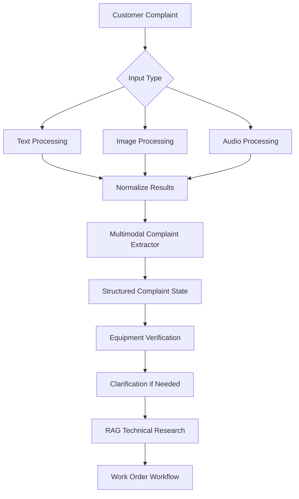
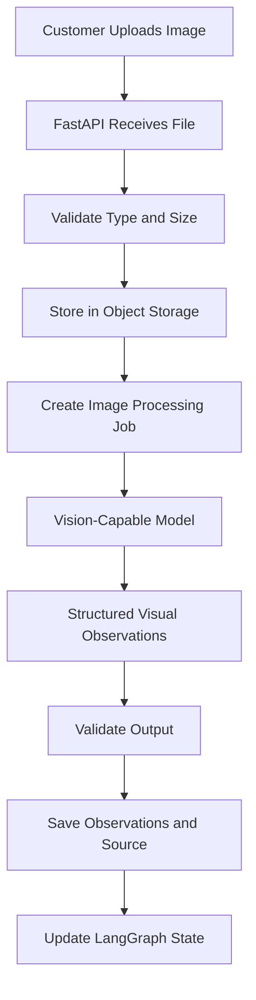
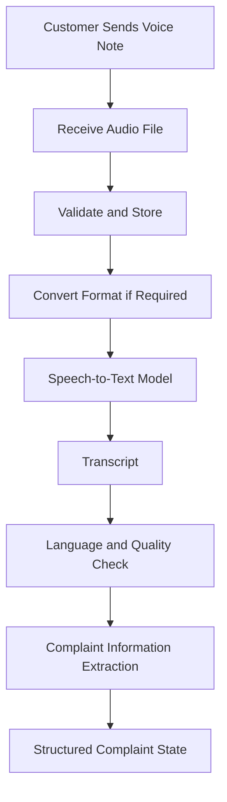
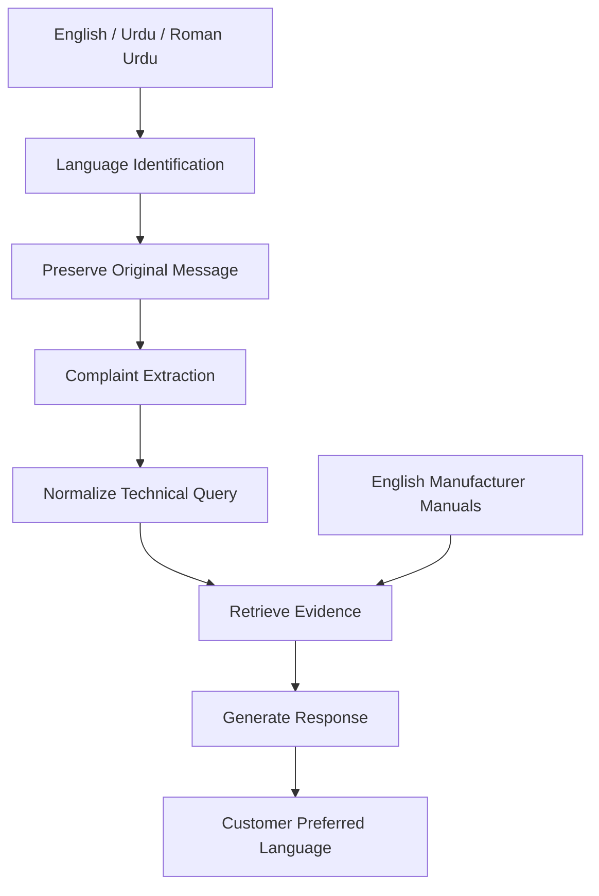
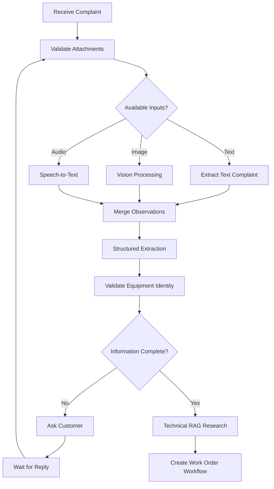
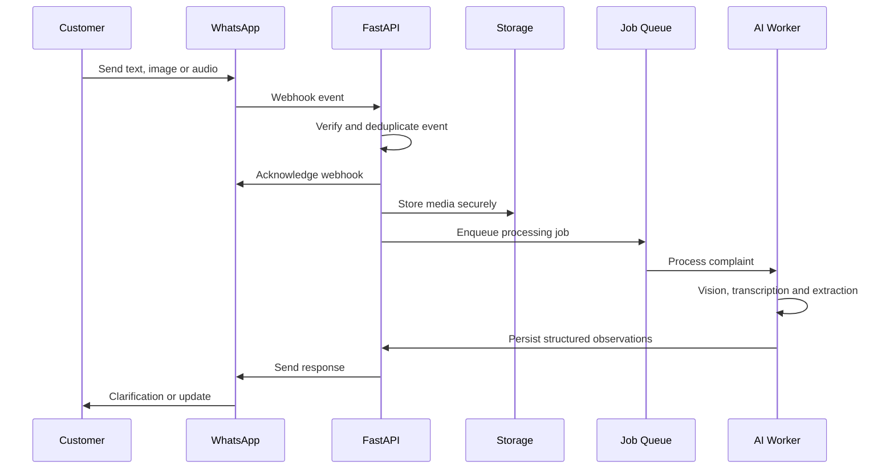
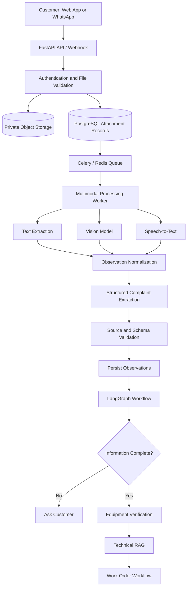

# FieldOps AI — Multimodal AI: Images, Voice and Customer Communication

**FieldOps AI: Autonomous Field-Service Coordination Platform**

This document designs how FieldOps AI understands complaints that contain more than text. Real customers don't always describe technical problems clearly. A customer might send:

- A photo of an inverter displaying a warning.
- A voice message explaining that electricity generation has stopped.
- A screenshot of an equipment monitoring application.
- A short written message in Roman Urdu.
- A combination of text, photographs and voice notes.

A text-only chatbot cannot properly handle all these inputs. A multimodal AI pipeline is needed that can process different input types, extract useful information, and combine the results into one structured complaint.

The document covers:

1. Multimodal AI and its role in FieldOps AI.
2. Image understanding using vision models.
3. Error-code and indicator extraction.
4. Voice processing using speech-to-text.
5. English, Urdu and Roman Urdu handling.
6. Audio and image storage.
7. Combining multimodal information with RAG.
8. Integrating multimodal processing with LangGraph and `create_agent`.
9. Evaluating reliability and preventing unsupported diagnoses.

**Contents**

1. [What is multimodal AI?](#1-what-is-multimodal-ai)
2. [Overall multimodal architecture](#2-overall-multimodal-architecture)
3. [Image understanding](#3-image-understanding--processing-equipment-photographs)
4. [OCR vs. vision models](#4-ocr-versus-vision-models--are-both-needed)
5. [Voice processing](#5-voice-processing--converting-customer-speech-into-text)
6. [English, Urdu and Roman Urdu support](#6-english-urdu-and-roman-urdu-support)
7. [Combining text, images and voice](#7-combining-text-images-and-voice-into-one-complaint)
8. [Integrating with LangGraph](#8-integrating-multimodal-processing-with-langgraph)
9. [Where `create_agent` and Deep Agents fit](#9-where-create_agent-and-deep-agents-fit-in-multimodal-processing)
10. [WhatsApp integration](#10-whatsapp-integration--receiving-images-and-voice-notes)
11. [Media storage and database design](#11-media-storage-and-database-design)
12. [Multimodal safety and reliability](#12-multimodal-safety-and-reliability)
13. [Multimodal evaluation](#13-multimodal-evaluation--how-to-test-the-system)
14. [Final multimodal architecture](#14-final-multimodal-architecture-for-fieldops-ai)
15. [Implementation sequence](#15-recommended-implementation-sequence)
16. [Python packages and documentation](#16-recommended-python-packages-and-documentation)
17. [Final architecture decisions](#17-final-architecture-decisions)

---

## 1. What is multimodal AI?

Traditional language models primarily process text. Multimodal AI systems can process multiple types of information, including:

- Text.
- Images.
- Audio.
- Video.
- Structured sensor data.

For FieldOps AI, three modalities are needed initially:

- **Text understanding:** customer messages, symptoms, equipment details and error descriptions.
- **Image understanding:** equipment photographs, warning indicators, visible displays and screenshots.
- **Voice understanding:** customer voice messages converted into text and structured information.

There is no need to train a custom multimodal model. Existing models and services can be integrated through APIs.

### Example: one complaint, three modalities

Imagine a customer submits:

- **Text:** "My solar system has stopped generating electricity."
- **Image:** a photograph of an inverter display showing a visible warning code.
- **Voice:** "Kal se bijli generate nahi ho rahi aur inverter par red light aa rahi hai."

The system should combine these into one structured complaint:

```json
{
  "equipment_type": "solar_inverter",
  "reported_symptoms": [
    "power_generation_stopped",
    "red_indicator_visible"
  ],
  "visible_error_code": "E-05",
  "customer_language": "Roman Urdu",
  "input_sources": [
    "text",
    "image",
    "audio"
  ],
  "requires_equipment_verification": true
}
```

This is illustrative data, not a real diagnosis of any particular inverter.

Notice that the system separates what the customer reported from what the image appears to show. That distinction is important.

## 2. Overall multimodal architecture

All input types eventually produce a common structured representation:

- Text becomes extracted complaint information.
- Images become visual observations.
- Audio becomes transcribed text and extracted information.

Then the existing LangGraph workflow can continue processing the complaint. This avoids building three completely independent complaint-management systems.



## 3. Image understanding — processing equipment photographs

Images are likely to provide useful information in a field-service application. A customer might upload:

- A photograph of an inverter display.
- A photograph of a warning indicator.
- A photograph of damaged equipment.
- A screenshot from an inverter monitoring application.
- A photograph of a solar installation.

The objective is to extract useful observations from these images.

### What can a vision model do?

A vision-capable LLM can:

1. Describe visible equipment.
2. Read visible text and error codes.
3. Identify visible warning indicators.
4. Describe apparent external damage.
5. Extract information from screenshots.
6. Compare observations across multiple photographs.

For example, if a customer uploads a photograph of an inverter display, the vision model might return (hypothetical extraction result):

```json
{
  "visible_objects": [
    "solar inverter",
    "display panel"
  ],
  "visible_text": [
    "E-05"
  ],
  "visible_indicators": [
    {
      "indicator": "red light",
      "state": "illuminated"
    }
  ],
  "image_quality": "acceptable",
  "uncertainties": [
    "The full equipment model is not visible"
  ]
}
```

The vision model has identified visible information. It has not established the underlying electrical fault.

### What it should NOT do

This distinction is critical. Suppose the photograph shows a red warning light. The model should not automatically conclude:

- The inverter's internal circuit is damaged.
- The grid connection has failed.
- A particular component must be replaced.
- The system is safe to operate.

Those conclusions require technical evidence, and some require physical inspection by a qualified technician. A vision model can describe what is visible. It cannot reliably inspect internal electrical components through an ordinary photograph.

### Recommended image-processing architecture



The image should be stored separately from the business database. PostgreSQL stores its storage key, metadata and relationship to the complaint.

### Which vision model should be used?

There are two practical options:

| Approach | Example | Trade-off |
| --- | --- | --- |
| Vision-capable hosted LLM | A provider's vision-enabled model | Easy to integrate, but API cost and external processing |
| Open-source vision model | A suitable vision-language model deployed locally | More control, but requires suitable hardware and deployment work |

For an FYP, start with a hosted vision-capable model. A local model can be evaluated later if cost, privacy or deployment requirements justify it. The model provider's API documentation should be checked for supported image formats, image detail settings, file-size limits and image-processing costs.

### Example: sending an image through LangChain

LangChain supports multimodal message content, although the exact image block format can vary by model integration. A common OpenAI-style message format looks like this:

```python
from langchain_openai import ChatOpenAI
from langchain_core.messages import HumanMessage

model = ChatOpenAI(
    model="YOUR_VISION_CAPABLE_MODEL",
    temperature=0
)

message = HumanMessage(
    content=[
        {
            "type": "text",
            "text": """
            Examine this inverter photograph.

            Extract only information visibly supported
            by the image.

            Return:
            - visible equipment
            - visible error codes
            - visible indicators
            - image quality
            - uncertainties

            Do not diagnose internal electrical faults.
            """
        },
        {
            "type": "image_url",
            "image_url": {
                "url": "https://your-secure-image-url"
            }
        }
    ]
)
```

This example assumes the selected model integration supports OpenAI-style image content and accepts the supplied image URL. In production, a short-lived, access-controlled image URL or an appropriate supported file-upload mechanism should be used. A public URL must not be exposed for private customer photographs.

LangChain's standardized content-block abstraction helps normalize multimodal messages across model integrations.

### Image quality checking

Poor-quality photographs need to be handled. For example:

- The display is blurry.
- The error code is partially hidden.
- The image is too dark.
- The equipment is photographed from too far away.
- The image is rotated.

Instead of forcing the model to guess, a structured result should be returned:

```json
{
  "readability": "poor",
  "error_code": null,
  "reason": "Display text is blurry",
  "recommended_action": "Request a clearer photograph"
}
```

The system can then ask:

> Please upload a closer, clearer photograph of the inverter display so we can read the error code.

This is better than inventing an error code.

## 4. OCR versus vision models — are both needed?

OCR (Optical Character Recognition) converts text visible in an image into machine-readable text. For example, a photograph might contain:

```
INVERTER STATUS

Error: E-05

Grid: OFF

Output: 0.0 kW
```

OCR attempts to extract those words and values. A vision model can do more: it can describe the scene, interpret the relationship between visible elements and answer questions about the image.

### Comparison

| Capability | Traditional OCR | Vision LLM |
| --- | --- | --- |
| Read visible text | Yes | Yes, with possible mistakes |
| Extract error codes | Yes | Yes, with possible mistakes |
| Describe equipment | Limited | Yes |
| Describe visible damage | Limited | Yes |
| Understand visual context | Limited | Better, but not guaranteed |
| Interpret diagrams | Limited | Model-dependent |
| Reliable technical diagnosis | No | No |

### Should FieldOps AI use both?

Not necessarily from the beginning. The recommended approach:

1. Start with a vision-capable model.
2. Test its error-code extraction on actual equipment photographs.
3. Compare it against OCR.
4. Add a dedicated OCR pipeline if it materially improves accuracy or cost.

For dense display text, a dedicated OCR tool may be more predictable. For broader visual understanding, a vision model is more flexible. A hybrid approach may eventually be useful:

```
Image
  |
  +----> OCR
  |        |
  |        +----> Extracted text
  |
  +----> Vision Model
           |
           +----> Visual observations

                 |
                 v
          Combine and validate
```

> If OCR and the vision model disagree about an error code, one should not be chosen arbitrarily. The disagreement should be flagged and a clearer image or human verification requested.

## 5. Voice processing — converting customer speech into text

In Pakistan, customers may prefer sending a voice note instead of typing a detailed technical complaint. For example:

> "Kal raat se inverter band hai. Display par red light aa rahi hai aur bijli generate nahi ho rahi."

The application needs to convert that recording into text. This process is called Automatic Speech Recognition (ASR), commonly called speech-to-text.

### Voice-processing pipeline



### Example transcript

Input audio:

```
"Kal raat se inverter band hai.
Display par red light aa rahi hai.
Bijli generate nahi ho rahi."
```

Transcription output:

```json
{
  "transcript": "Kal raat se inverter band hai. Display par red light aa rahi hai. Bijli generate nahi ho rahi.",
  "language": "ur",
  "input_script": "roman",
  "confidence": null
}
```

The `confidence` value is null here because a trustworthy confidence score from the transcription provider has not been established. Confidence scores should not be invented when the API does not supply them.

### Which speech-to-text model should be used?

Options to evaluate:

- Hosted transcription models.
- Open-source Whisper-based systems.
- Other multilingual ASR services.

For a new hosted integration, the current transcription documentation should be checked. OpenAI's documentation at the time of writing recommended `gpt-transcribe` for recorded audio; older `whisper-1` and some other transcription integrations have deprecation timelines, so a new project should not be built around an older tutorial without checking its status.

### Example: transcribing an audio file

A separate transcription service is often simpler than trying to make every agent directly understand audio. For example, using the OpenAI Python SDK:

```bash
pip install openai
```

```python
from openai import OpenAI

client = OpenAI()


def transcribe_audio(file_path: str):
    with open(file_path, "rb") as audio_file:
        result = client.audio.transcriptions.create(
            model="gpt-transcribe",
            file=audio_file
        )

    return result.text
```

This is an example of a provider-specific service, not a LangChain agent. It can be called from FastAPI or a Celery worker, and the transcript passed into the LangGraph workflow. The model name and supported file formats should be verified against the provider documentation at implementation time.

### Why separate transcription from complaint reasoning?

The two tasks have different responsibilities.

| Service | Responsibility |
| --- | --- |
| Speech-to-text | Convert speech into words |
| LLM extraction | Understand symptoms and equipment details |
| LangGraph | Coordinate the workflow |
| Backend | Validate and store the results |

If transcription produces the wrong words, the complaint extraction stage should not silently treat them as facts. For example, if a customer says "E zero five" but the transcript says "E zero nine", the system should recognize that error-code transcription needs verification.

## 6. English, Urdu and Roman Urdu support

This is particularly important for FieldOps AI's target market. Customers may communicate in several ways:

| Input | Example |
| --- | --- |
| English | My inverter stopped generating electricity. |
| Urdu script | میرا انورٹر بجلی پیدا نہیں کر رہا۔ |
| Roman Urdu | Mera inverter bijli generate nahi kar raha. |
| Mixed language | Inverter band hai aur display par error aa raha hai. |

The system should not assume that every customer will use formal English.

### The challenge with Roman Urdu

Roman Urdu doesn't have one standardized spelling system. The same phrase might be written in different ways:

```
bijli generate nahi ho rahi

bijli genrate ni horhi

electricity paida nahi ho rahi

light nahi aa rahi
```

These variations can make language detection, transcription and semantic retrieval more difficult.

### Recommended language pipeline

1. Accept the customer's original language.
2. Transcribe voice messages in their original language.
3. Detect the language or mixed-language content.
4. Preserve the original transcript.
5. Extract structured complaint information.
6. Create an optional normalized English technical query for RAG.
7. Generate the customer-facing response in the customer's preferred language.



### Why preserve the original language?

Suppose the customer says:

> Inverter ki light lal ho rahi hai.

The system normalizes it to:

> The inverter's red indicator is illuminated.

Both should be stored. The original message preserves what the customer actually said. The normalized version makes technical retrieval easier.

### Do not translate technical identifiers

These should remain unchanged:

- Error codes.
- Model numbers.
- Serial numbers.
- Voltage measurements.
- Equipment names.
- Manufacturer part numbers.

For example:

```
Original:
Mera inverter E-05 show kar raha hai.

Normalized:
The inverter is displaying error code E-05.
```

`E-05` must not accidentally be transformed into another code during translation.

### Recommendation for language support

Start with English and Roman Urdu, then test Urdu script and mixed-language messages. The system should not be claimed to support all Pakistani languages just because the LLM can generate text in them; actual transcription and extraction accuracy should be evaluated for each language.

## 7. Combining text, images and voice into one complaint

This is the most important architectural part of this document. There are three input pipelines (text, image and audio processing), and a common data structure is needed to combine them. Pydantic schemas are recommended for this purpose.

### Example: multimodal complaint schema

```python
from pydantic import BaseModel, Field


class VisualObservation(BaseModel):
    visible_text: list[str] = Field(
        default_factory=list
    )

    visible_indicators: list[str] = Field(
        default_factory=list
    )

    apparent_damage: list[str] = Field(
        default_factory=list
    )

    uncertainties: list[str] = Field(
        default_factory=list
    )


class AudioObservation(BaseModel):
    transcript: str
    language: str | None = None

    uncertainties: list[str] = Field(
        default_factory=list
    )


class MultimodalComplaint(BaseModel):
    customer_message: str | None = None

    reported_symptoms: list[str] = Field(
        default_factory=list
    )

    visual_observations: list[VisualObservation] = Field(
        default_factory=list
    )

    audio_observations: list[AudioObservation] = Field(
        default_factory=list
    )

    visible_error_codes: list[str] = Field(
        default_factory=list
    )

    equipment_type: str | None = None

    missing_information: list[str] = Field(
        default_factory=list
    )

    requires_clarification: bool = False
```

This is a simplified starting schema. In production, source IDs, extraction timestamps, validation statuses and confidence information (where actually available) should be added.

### Example combined result

Suppose a customer submits:

- Text: "My solar system is not generating electricity."
- Image: an inverter display with a visible E-05.
- Voice: "Kal se inverter par red light aa rahi hai."

The application processes them separately. Then the complaint extraction stage combines their results:

```json
{
  "customer_message": "My solar system is not generating electricity.",
  "reported_symptoms": [
    "power_generation_stopped",
    "red_indicator_reported"
  ],
  "visible_error_codes": [
    "E-05"
  ],
  "equipment_type": "solar_inverter",
  "missing_information": [
    "registered_equipment_model_not_verified"
  ],
  "requires_clarification": true
}
```

Notice that the error code came from the image, while the power-generation problem came from the customer. These facts should retain their sources.

### Add source attribution

For a real implementation, each extracted observation should be stored with its origin:

```json
{
  "observations": [
    {
      "field": "power_generation",
      "value": "not_generating",
      "source_type": "customer_text"
    },
    {
      "field": "error_code",
      "value": "E-05",
      "source_type": "image",
      "source_id": "IMG-001"
    },
    {
      "field": "red_indicator",
      "value": "reported_illuminated",
      "source_type": "customer_audio",
      "source_id": "AUD-001"
    }
  ]
}
```

This makes the system more auditable. If two sources conflict, the system can identify the conflict rather than silently merging them.

## 8. Integrating multimodal processing with LangGraph

LangGraph manages the workflow. It does not need to perform every image and audio operation itself. Separate processing functions can be created and called from workflow nodes.

### Proposed workflow



### Suggested LangGraph state

The state designed earlier can be extended:

```python
from typing import TypedDict


class FieldOpsState(TypedDict):
    complaint_id: str
    customer_id: str
    equipment_id: str | None

    customer_message: str | None
    attachment_ids: list[str]

    image_observations: list[dict]
    audio_transcripts: list[dict]

    extracted_symptoms: list[str]
    visible_error_codes: list[str]

    missing_information: list[str]
    requires_clarification: bool

    manual_evidence: list[dict]

    work_order_id: str | None
    workflow_status: str
```

This state is a workflow representation, not a replacement for PostgreSQL business records.

### Recommended nodes

| Node | Responsibility |
| --- | --- |
| `receive_complaint` | Load complaint and attachment records |
| `process_text` | Extract information from customer text |
| `process_images` | Analyze uploaded photographs |
| `transcribe_audio` | Convert voice messages into text |
| `merge_observations` | Combine observations and retain source references |
| `extract_complaint` | Create structured complaint fields |
| `validate_equipment` | Verify equipment identity against PostgreSQL |
| `check_completeness` | Identify missing required information |
| `ask_clarification` | Send a question through the original channel |
| `technical_research` | Retrieve relevant manual sections |

### Is a separate agent needed for every modality?

No. This is a common architecture mistake. The following are not needed:

- An image agent.
- An audio agent.
- A text agent.
- A multimodal agent.
- A complaint agent.

All these agents would add orchestration complexity without necessarily improving the system. The recommendation is ordinary processing services for image analysis and transcription, followed by one complaint-extraction agent or structured LLM call. `create_agent` should be used only where flexible tool selection and reasoning are genuinely useful, and LangGraph should coordinate the complete workflow.

## 9. Where `create_agent` and Deep Agents fit in multimodal processing

### `create_agent`

`create_agent` can be used for complaint investigation after the input pipelines have produced structured observations. Its tools might include:

- `get_equipment_details`
- `get_customer_history`
- `search_manual`
- `ask_customer_clarification`

The agent can decide which information it needs to investigate. For example:

```python
from langchain.agents import create_agent

complaint_agent = create_agent(
    model="YOUR_PROVIDER:YOUR_MODEL",
    tools=[
        get_equipment_details,
        get_customer_history,
        search_manual
    ],
    system_prompt="""
    You are a field-service complaint investigation agent.

    Use verified equipment records.

    Distinguish customer-reported symptoms
    from image-derived observations.

    Do not invent error codes or diagnoses.

    Request clarification when essential
    information is missing.

    Escalate uncertain technical cases.
    """
)
```

This is a conceptual integration example; the actual tool functions must enforce authentication and equipment ownership.

### Deep Agents

Would Deep Agents help with an ordinary customer photograph? No. A simple image-analysis task does not justify a Deep Agent. Could they help with a complex investigation involving hundreds of photographs, historical reports, equipment manuals and independent technical research tasks? Potentially, yes. But that belongs to a later advanced investigation feature, not the initial multimodal complaint workflow.

> The key principle remains: use the simplest component that reliably performs the task.

## 10. WhatsApp integration — receiving images and voice notes

Both the web application and WhatsApp are complaint channels, so the handling of multimedia messages entering the system must be considered. The WhatsApp Business Platform can deliver incoming message events through webhooks. Media messages require additional processing to retrieve the associated media file.

### Example WhatsApp workflow

A customer sends a text complaint, an inverter photograph and a voice note. The flow looks like this:



### Important technical details

**1. Webhook verification.** The FastAPI application must verify incoming webhook requests using the official platform's verification and security mechanisms. Arbitrary requests must not be accepted as genuine WhatsApp events.

**2. Duplicate events.** Webhook delivery can be retried. The provider's message or event identifier should be stored and uniqueness enforced so that the same message does not create duplicate complaints or trigger duplicate AI processing.

**3. Media retrieval.** For image and audio messages:

- Receive the media identifier.
- Retrieve the media through the authorized provider API.
- Validate the returned media type.
- Download the content.
- Store it securely.
- Create an attachment record in PostgreSQL.

**4. File format conversion.** Some audio messages may arrive in formats that the selected transcription service does not support. A media-processing tool such as FFmpeg should be used when conversion is required. It should not be assumed that every WhatsApp voice note can be passed directly to every transcription API.

**5. Response delivery.** The application should send clarification questions or updates through the same channel whenever possible. For example:

> I received your photograph, but the inverter display is not clear enough to read the error code. Please send a closer photograph of the display.

WhatsApp's messaging-window and approved-template rules must also be accounted for when sending messages outside the permitted customer-service window. The official integration documentation should be the source of truth for webhook payloads, media retrieval and messaging restrictions.

## 11. Media storage and database design

Object storage should be used for the actual files and PostgreSQL for their metadata. Examples of object storage include:

- Amazon S3.
- Cloudflare R2.
- MinIO for self-hosted development.
- Another compatible object-storage service.

### Why not store all images directly in PostgreSQL?

PostgreSQL can store binary files, but large media files can increase database size, backups and operational overhead. A better separation is:

- **Object storage:** actual image, audio and PDF files.
- **PostgreSQL:** metadata, relationships, storage keys and processing results.

### Suggested database table

```sql
CREATE TABLE complaint_attachments (
    id UUID PRIMARY KEY DEFAULT gen_random_uuid(),

    complaint_id UUID NOT NULL
        REFERENCES complaints(id),

    uploaded_by UUID NOT NULL
        REFERENCES users(id),

    media_type VARCHAR(30) NOT NULL,

    storage_key TEXT NOT NULL,

    original_filename TEXT,

    mime_type VARCHAR(100),

    file_size_bytes BIGINT,

    processing_status VARCHAR(30)
        DEFAULT 'pending',

    created_at TIMESTAMPTZ
        DEFAULT NOW()
);
```

`media_type` values might include `image`, `audio` and `document`.

### Separate processing results

A separate table should also be maintained for AI-generated observations:

```sql
CREATE TABLE attachment_observations (
    id UUID PRIMARY KEY DEFAULT gen_random_uuid(),

    attachment_id UUID NOT NULL
        REFERENCES complaint_attachments(id),

    observation_type VARCHAR(40) NOT NULL,

    extracted_data JSONB NOT NULL,

    model_name VARCHAR(150),

    processing_status VARCHAR(30),

    created_at TIMESTAMPTZ
        DEFAULT NOW()
);
```

This tracks which image or audio file produced each observation. For example:

| Attachment | Type | Processing result |
| --- | --- | --- |
| IMG-001 | Image | Visible code E-05 |
| AUD-001 | Audio | Customer transcript |
| IMG-002 | Image | Unreadable display |

Processing can also be rerun with a newer model without overwriting the original file.

### Security considerations

Customer media can contain sensitive information. For example:

- A photograph might show a person's home.
- A screenshot might reveal account information.
- A voice note might contain personal details.
- An image might accidentally expose a location.

Implement:

- Private object storage.
- Short-lived signed download URLs.
- File-type and file-size validation.
- Malware scanning where appropriate.
- Role-based access control.
- Retention and deletion policies.
- Encryption in transit and at rest.
- Audit logs for media access.

A customer's private attachment must never be exposed simply because someone knows its storage URL.

## 12. Multimodal safety and reliability

This is one of the most important parts of the design. Multimodal models can make mistakes. A model might:

- Read `E-05` as `E-06`.
- Interpret a red indicator incorrectly.
- Miss a warning in a blurry image.
- Mishear a technical term in a voice note.
- Confuse one equipment model with another.
- Infer damage that is not actually visible.

The system needs to be designed around these failures.

### A. Preserve source information

Every observation should have a source. For example:

```json
{
  "field": "error_code",
  "value": "E-05",
  "source": {
    "type": "image",
    "attachment_id": "IMG-001"
  },
  "verification_status": "unverified"
}
```

### B. Separate reported facts from model interpretations

| Information | Source | Status |
| --- | --- | --- |
| Power generation stopped | Customer | Reported |
| Red indicator illuminated | Photograph | Visually observed |
| E-05 displayed | Photograph | Extracted, unverified |
| Internal inverter fault | AI | Not established |

This separation is essential.

### C. Ask for confirmation when necessary

If the model cannot reliably read a code:

> I couldn't read the error code clearly. Could you please confirm the code displayed on the inverter?

### D. Apply deterministic safety rules

The backend should reject or escalate certain actions regardless of what the LLM recommends. For example:

- A customer should not be instructed to open electrical equipment.
- The agent should not certify that a solar installation is electrically safe.
- The model should not independently authorize hazardous repair work.
- A technician's safety-sensitive work must follow approved company procedures.

The system can coordinate maintenance, but it must not replace qualified technical judgment.

### E. Don't trust confidence values blindly

Some models provide confidence-like values, but these are not necessarily calibrated probabilities. A model saying it is 95% confident does not prove that its observation is correct 95% of the time. Actual accuracy should be measured using a labeled test dataset.

## 13. Multimodal evaluation — how to test the system

Image processing, audio processing and combined complaint extraction should be tested separately. Otherwise, if the final complaint is incorrect, it won't be clear which component caused the error.

### A. Image evaluation

Prepare a test set containing photographs of:

- Clear inverter displays.
- Blurry displays.
- Low-light photographs.
- Different equipment models.
- Screenshots.
- Partially obscured error codes.
- Images without visible error codes.

Evaluate:

| Metric | Purpose |
| --- | --- |
| Error-code exact match | Was the displayed code read correctly? |
| Equipment identification accuracy | Was the correct equipment identified? |
| Indicator classification accuracy | Were visible indicators described correctly? |
| Unsupported observation rate | Did the model claim something not visible? |
| Abstention rate | Did it correctly report unreadable images? |

For error codes, exact match is particularly important. Reading `E-05` as `E-06` should count as an incorrect result, not a near match.

### B. Audio evaluation

Prepare voice recordings in:

- English.
- Urdu.
- Roman Urdu-style speech.
- Mixed English and Urdu.
- Noisy environments.
- Different speaking speeds.

Evaluate Word Error Rate (WER):

$$
\text{WER} = \frac{S + D + I}{N}
$$

Where:

- $S$ = substitutions.
- $D$ = deletions.
- $I$ = insertions.
- $N$ = number of words in the reference transcript.

However, WER alone is not sufficient. For FieldOps AI, whether the transcription preserves the following should be evaluated separately:

- Error codes.
- Equipment model numbers.
- Measurements.
- Technical terms.
- Negations such as "not working".

A transcript can have a relatively low WER while still getting a critical error code wrong.

### C. Complaint extraction evaluation

Create test examples containing text, images and voice. Measure:

- Symptom extraction precision and recall.
- Equipment identification accuracy.
- Missing-information detection.
- Source attribution correctness.
- Contradiction detection.
- Correct clarification decisions.

### D. Example test dataset

For an initial experiment:

| Test category | Suggested examples |
| --- | --- |
| Clear equipment photographs | 20 |
| Blurry or difficult photographs | 15 |
| Voice messages in English | 15 |
| Voice messages in Urdu/Roman Urdu | 20 |
| Mixed text, image and voice complaints | 15 |
| Ambiguous or contradictory complaints | 15 |
| **Total** | **100** |

These are proposed testing proportions, not a claim about real-world complaint distributions. Expected answers for the test cases should be manually reviewed.

### E. Compare processing strategies

| Experiment | Configuration |
| --- | --- |
| 1 | Text-only complaint extraction |
| 2 | Text + vision |
| 3 | Text + audio transcription |
| 4 | Text + image + audio |
| 5 | Multimodal extraction with source validation |

Then compare accuracy, latency and cost. This can become a useful experimental component of the FYP report.

## 14. Final multimodal architecture for FieldOps AI



### Responsibilities of each component

| Component | Responsibility |
| --- | --- |
| React | Customer and technician interfaces |
| WhatsApp Business Platform | Incoming customer messages |
| FastAPI | APIs, webhooks and validation |
| Object storage | Images, audio and documents |
| PostgreSQL | Complaint records, attachments and observations |
| Redis + Celery | Background processing and retries |
| Vision model | Image understanding |
| Speech-to-text | Audio transcription |
| LLM | Structured complaint extraction |
| LangGraph | Workflow orchestration |
| LangChain `create_agent` | Flexible reasoning and tool selection where needed |
| RAG | Equipment-specific technical knowledge |

The architecture remains a modular monolith. No unnecessary microservices or separate agents for every input type are introduced.

## 15. Recommended implementation sequence

Multimodal processing is implemented in four phases.

### Phase 1 — Essential: text and image processing

- Accept text complaints.
- Upload equipment photographs.
- Analyze photographs using a vision model.
- Extract visible error codes.
- Store image observations with source references.
- Ask for a clearer image when necessary.

### Phase 2 — Advanced MVP: voice processing

- Accept audio files.
- Transcribe English and Urdu speech.
- Test Roman Urdu.
- Extract structured complaint information.
- Preserve original recordings and transcripts according to retention rules.

### Phase 3 — Integration

- Combine text, images and audio.
- Preserve observation sources.
- Detect contradictions.
- Integrate with LangGraph.
- Connect to the technical RAG pipeline.

### Phase 4 — Production hardening

- WhatsApp multimedia integration.
- Retry and failure handling.
- File security.
- Evaluation datasets.
- Latency and cost optimization.

### Minimum deliverable for the FYP

| Feature | MVP requirement |
| --- | --- |
| Web complaint submission | Yes |
| WhatsApp complaint submission | Yes, once the core flow works |
| Text understanding | Yes |
| Image understanding | Yes |
| Error-code extraction | Yes |
| Voice transcription | Yes, if time and language accuracy permit |
| Urdu/Roman Urdu testing | Yes |
| Video analysis | No |
| Real-time audio conversations | No |
| Custom-trained vision model | No |
| Automatic electrical fault certification | No |

One adjustment to the earlier implementation plan: build the web application first, then integrate WhatsApp. The final system can support both channels without requiring both integrations to be developed simultaneously.

## 16. Recommended Python packages and documentation

### Python packages

```bash
pip install \
    langchain \
    langchain-core \
    langchain-openai \
    langgraph \
    openai \
    fastapi \
    python-multipart \
    pydantic \
    sqlalchemy \
    pymupdf
```

Additional tools when required:

```bash
pip install \
    celery \
    redis \
    pillow
```

FFmpeg should be installed separately if audio conversion is required. A dedicated OCR package is not needed immediately if the vision model can handle the initial image-extraction requirements; one can be added after evaluating the results.

### Official documentation

**LangChain multimodal support**

- [LangChain models and multimodal inputs](https://docs.langchain.com/oss/python/langchain/models)
- [LangChain standardized content blocks](https://reference.langchain.com/python/langchain-core/messages/content)

**Image understanding**

- [OpenAI image and vision guide](https://developers.openai.com/api/docs/guides/images-vision)

**Audio and speech-to-text**

- [Audio transcription guide](https://developers.openai.com/api/docs/guides/transcription)
- [File transcription guide](https://developers.openai.com/api/docs/guides/speech-to-text)

**WhatsApp integration**

- [WhatsApp Cloud API webhooks](https://developers.facebook.com/docs/whatsapp/cloud-api/webhooks)
- [WhatsApp media API](https://developers.facebook.com/docs/whatsapp/cloud-api/reference/media)

A note about provider selection: the OpenAI examples in this document are implementation examples, not a requirement to use OpenAI for every modality. Other providers can be compared based on language accuracy, vision quality, cost, privacy and latency.

## 17. Final architecture decisions

| Area | Decision |
| --- | --- |
| Customer input | Text, image and voice |
| Initial interface | React web application |
| Additional channel | WhatsApp Business Platform |
| Image analysis | Hosted vision-capable LLM |
| OCR | Dedicated OCR only when evaluation justifies it |
| Audio processing | Speech-to-text service |
| Language support | English and Roman Urdu initially; evaluate Urdu script |
| Complaint extraction | Structured LLM output validated with Pydantic |
| Multimodal integration | Separate processing services |
| Orchestration | LangGraph |
| Agent usage | Bounded `create_agent` where useful |
| Media storage | Private object storage |
| Media metadata | PostgreSQL |
| Background processing | Celery + Redis |
| Source attribution | Every observation linked to its original input |
| Safety | No autonomous electrical safety certification |
| Evaluation | Exact error-code accuracy, WER, extraction accuracy and abstention quality |

The most important principle:

> A multimodal AI system should distinguish what the customer said, what the model observed, and what has actually been verified. That distinction makes FieldOps AI more reliable and easier to audit.
