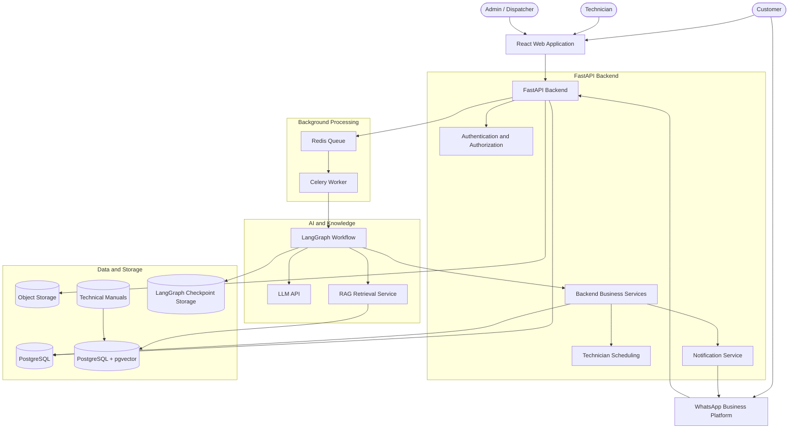
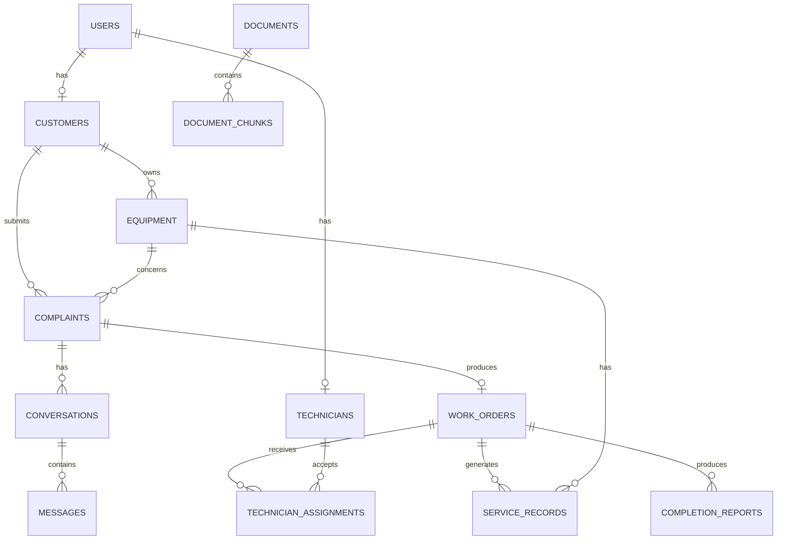
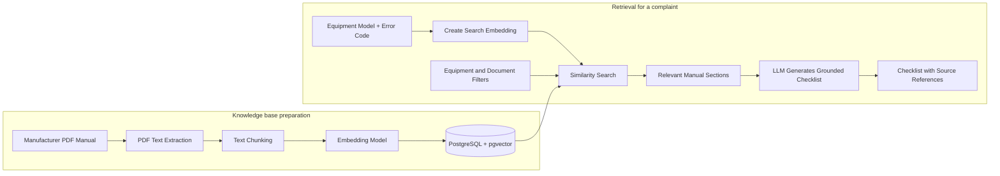

# FieldOps AI — System Architecture

**FieldOps AI: Autonomous Field-Service Coordination Platform**

This document turns FieldOps AI from a project concept into a technical system that a student development team can realistically build.

**Core architectural decision:** build FieldOps AI as a **modular monolith**, not as a collection of microservices. That means one main backend application, organized into separate modules with clear responsibilities. It is easier to develop, test, debug, and deploy while still supporting sophisticated AI workflows.

## 1. Overall architecture

The system is organized into six layers.

| Layer | Technology | Responsibility |
| --- | --- | --- |
| User interface | React + TypeScript | Customer, technician and admin interfaces |
| API and integrations | FastAPI | Receives requests, authenticates users, handles webhooks |
| Workflow orchestration | LangGraph | Coordinates the complaint-to-completion AI workflow |
| AI and knowledge | LLM API, vision, RAG | Understands complaints and retrieves technical information |
| Business logic | Python services | Validates work orders, assigns technicians, enforces rules |
| Data and infrastructure | PostgreSQL, pgvector, Redis, Celery, object storage | Stores records, documents, files and background jobs |

### 1.1 Presentation layer

There are three types of users:

- **Customer:** submits complaints, uploads photos, answers questions and tracks service requests.
- **Technician:** views assigned jobs, follows diagnostic checklists and submits repair evidence.
- **Admin/Dispatcher:** monitors operations, manages technicians and handles escalations.

React can provide all three interfaces in one application; the backend determines what each role is permitted to access. WhatsApp is an additional customer-facing channel, not a replacement for the React application.

### 1.2 API layer — FastAPI

FastAPI is the entry point into the backend. For example, when a customer submits a complaint, React sends:

```
POST /api/complaints
```

The backend:

1. Authenticates the user.
2. Validates the complaint data.
3. Saves the complaint in PostgreSQL.
4. Stores uploaded files in object storage.
5. Starts background processing.
6. Returns a complaint ID to the frontend.

FastAPI also handles technician updates, admin requests, and WhatsApp webhooks.

### 1.3 Workflow layer — LangGraph

LangGraph coordinates the AI workflow:

- Analyze complaint.
- Check missing information.
- Ask the customer questions.
- Retrieve technical documentation.
- Generate a diagnostic checklist.
- Prepare a work order.
- Request technician assignment.
- Process completion information.

It also manages workflow state, branching, and pauses.

### 1.4 AI and knowledge layer

This layer contains:

- LLM API for understanding and generating structured information.
- Vision capabilities for interpreting uploaded equipment photos.
- Speech-to-text for voice complaints, if included.
- RAG for retrieving relevant manufacturer manuals.
- Tool functions that allow the AI workflow to request authorized backend operations.

The AI layer does not directly control the database or make unrestricted business decisions.

### 1.5 Business logic layer

This is an especially important separation. Suppose the AI recommends assigning a solar repair to Technician A. The backend must independently verify:

- Does Technician A have the required skills?
- Is the technician available?
- Is the technician already assigned to another job at that time?
- Is the technician authorized for this equipment category?

Only after validation can the assignment be created.

> The LLM recommends and coordinates; the backend enforces the rules.

### 1.6 Data and infrastructure layer

- **PostgreSQL** stores customers, equipment, complaints, work orders, assignments and service records.
- **pgvector** enables similarity search over document embeddings.
- **Redis and Celery** handle background jobs and retries.
- **Object storage** holds uploaded photos, audio and PDF manuals.
- **LangGraph checkpoint storage** preserves the state of interrupted workflows.

## 2. Complete system architecture diagram



The diagram is a logical view. In the actual implementation, several of these components will live inside the same FastAPI codebase rather than running as separate services. For example, the RAG retrieval service, scheduling service, and notification service can initially be ordinary Python modules.

## 3. How the components communicate

Following one complaint through the architecture:

> "My solar system has stopped generating electricity. The inverter is showing a red warning light."

1. **Customer submits complaint.** React sends complaint text, equipment ID and image metadata to FastAPI.
2. **FastAPI saves the complaint.** PostgreSQL stores the complaint. The uploaded image is stored separately in object storage.
3. **Background processing starts.** FastAPI places a job in Redis. A Celery worker receives it.
4. **LangGraph begins execution.** The worker starts the complaint-processing workflow. LangGraph loads the relevant customer and equipment information.
5. **LLM analyzes the complaint.** It extracts the reported symptoms, identifies missing information and returns structured data.
6. **Workflow checks completeness.** If the inverter model or error code is missing, the system asks the customer for clarification and pauses the workflow.
7. **RAG retrieves technical information.** Once enough information is available, the retrieval service searches manuals for the specific inverter model.
8. **AI prepares a checklist.** LangGraph asks the LLM to generate a technician-facing checklist grounded in retrieved documentation.
9. **Backend validates and creates the work order.** It checks mandatory fields, equipment identity, permissions and applicable business rules before saving the official work order.
10. **Scheduling service assigns a technician.** It evaluates availability, skills and workload using deterministic rules.
11. **Technician completes the job.** The technician updates the job, submits findings, photos and required evidence.
12. **Completion is verified.** AI helps prepare the completion report. Backend rules check required evidence and decide whether the job can be closed or must be escalated.

**Important detail:** the customer clarification step does not keep a worker running while waiting for a response. LangGraph saves a checkpoint, the worker exits, and a later customer reply triggers the workflow to resume. This avoids wasting background workers while customers take minutes or hours to respond.

## 4. LangGraph vs. Celery vs. Redis

These three technologies all participate in workflow execution but have different jobs.

| Technology | What it does | Example |
| --- | --- | --- |
| LangGraph | Manages AI workflow state and decisions | Decide whether to ask a question or retrieve a manual |
| Celery | Executes background tasks | Start or resume complaint processing |
| Redis | Provides queue infrastructure and temporary shared data | Hold pending Celery jobs |

The sequence:

- FastAPI receives a complaint.
- Celery schedules a background task.
- Redis holds that task until a worker receives it.
- The worker starts LangGraph.
- LangGraph executes the AI workflow and saves its checkpoint.
- If customer input is needed, the workflow pauses.
- A later webhook or API request schedules another task to resume it.

> **Important:** LangGraph checkpoint persistence is a separate concern from the Celery queue. Storing Celery jobs in Redis does not automatically save LangGraph workflow state. A durable checkpoint backend must be configured explicitly. For this project, PostgreSQL-backed LangGraph checkpoints are a sensible option.

## 5. Database architecture

PostgreSQL is the source of truth for FieldOps AI. The AI may extract information, generate suggestions and recommend actions, but official business records must be stored and validated in the database.

### Main tables

| Table | Important fields | Purpose |
| --- | --- | --- |
| `users` | id, name, email, password_hash, role | Login accounts |
| `customers` | id, user_id, phone, address | Customer profiles |
| `technicians` | id, user_id, skills, availability | Technician profiles |
| `equipment` | id, customer_id, manufacturer, model, serial_number | Registered equipment |
| `complaints` | id, customer_id, equipment_id, description, status | Customer complaints |
| `conversations` | id, complaint_id, channel | Conversation sessions |
| `messages` | id, conversation_id, sender, content | Customer and AI messages |
| `documents` | id, manufacturer, model, file_path, version | Technical manuals |
| `document_chunks` | id, document_id, content, embedding | Searchable manual sections |
| `work_orders` | id, complaint_id, equipment_id, status, priority | Official repair jobs |
| `technician_assignments` | id, work_order_id, technician_id, status | Assignment history |
| `service_records` | id, equipment_id, work_order_id, findings | Historical maintenance |
| `completion_reports` | id, work_order_id, report, evidence_status | Repair completion reports |
| `workflow_runs` | id, complaint_id, workflow_status | Workflow tracking |

### How the tables relate



Key design decisions:

- One customer can own multiple pieces of equipment.
- One equipment item can have multiple complaints over time.
- One complaint can produce one official work order in the initial MVP.
- A work order can have multiple assignment records to preserve reassignment history.
- A piece of equipment can have many service records.
- One manual can contain many searchable chunks.

Foreign keys and database constraints should be used to maintain these relationships.

### Where do images and PDFs go?

Large image, audio, and PDF files should not be stored directly in ordinary PostgreSQL columns. Instead:

1. Upload the file to object storage.
2. Generate a unique storage path.
3. Save the path, file type, size and other metadata in PostgreSQL.
4. Retrieve the file through an authorized backend operation when needed.

For local development, local file storage is enough to start with. For deployment, use an object storage service.

## 6. RAG architecture inside FieldOps AI



Suppose the equipment is a particular inverter model and the customer reports error code E-05. The system should:

1. Identify the exact equipment model.
2. Search manuals associated with that model.
3. Retrieve relevant sections about E-05.
4. Provide those sections to the LLM.
5. Generate a checklist with references to the relevant manual pages.

**Metadata filtering is critical.** A similar error code from a different manufacturer or model should not automatically be treated as the correct answer.

**Retrieved content is untrusted input.** Retrieved PDF content provides technical information; it must never be allowed to override system instructions or authorize tool execution.

## 7. WhatsApp integration architecture

Both channels (web and WhatsApp) need to reach the same complaint-processing system. The recommended integration is the official WhatsApp Business Platform.

**Incoming message:**

1. Customer sends a message or photo.
2. WhatsApp sends a webhook event to FastAPI.
3. FastAPI verifies the webhook and identifies the customer.
4. The message is stored in PostgreSQL.
5. The complaint workflow is started or resumed.

**Outgoing message:**

1. LangGraph determines that clarification is needed.
2. The notification service prepares a message.
3. FastAPI sends it through the WhatsApp Business API.
4. The customer's reply arrives through another webhook.
5. The workflow resumes.

Two implementation details should not be overlooked:

- **Duplicate webhook events.** Webhook events can be delivered more than once. Store their unique IDs and use idempotency so duplicate events do not create duplicate messages or work orders.
- **Messaging rules.** WhatsApp has customer-service messaging windows and template-message rules. The notification service must respect them.

Build and test the web workflow first, then connect WhatsApp to the same backend. That keeps the AI workflow independent of the communication channel.

## 8. Authentication, authorization and AI safety

Because FieldOps AI handles customer information, equipment records and operational decisions, security must be part of the architecture from the beginning.

### User permissions

Use role-based access control (RBAC).

| Capability | Customer | Technician | Admin |
| --- | --- | --- | --- |
| Submit complaint | Yes | No | Yes |
| View own complaints | Yes | No | Yes |
| View assigned work orders | No | Yes | Yes |
| Update repair progress | No | Yes | Yes |
| Assign technicians | No | No | Yes |
| Manage equipment | Own equipment | Limited | Yes |
| Review escalations | No | No | Yes |

These permissions must be enforced by FastAPI, not merely hidden in React. For example, a technician must not be able to change a URL or API request to access another technician's private jobs.

### Security requirements

1. **Authentication:** secure login and session/token management.
2. **Authorization:** check role and resource ownership on every protected operation.
3. **Webhook verification:** verify incoming WhatsApp events.
4. **File security:** validate file types, sizes and access permissions.
5. **Secret management:** store API keys and credentials in environment variables or a secrets manager.
6. **Transport security:** use HTTPS in deployment.
7. **Audit logging:** record important actions, such as work-order creation and technician reassignment.
8. **Data protection:** minimize personal information sent to external LLM providers and understand their data-retention policies.

### AI safety boundaries

This is especially important because the project concerns solar and electrical equipment.

| AI action | Allowed? |
| --- | --- |
| Extract reported symptoms | Yes |
| Ask customers for clarification | Yes |
| Retrieve manufacturer documentation | Yes |
| Generate a technician-facing checklist | Yes, with grounded references |
| Recommend a work-order priority | Yes, subject to validation |
| Recommend a technician | Yes, subject to scheduling rules |
| Directly control electrical equipment | No |
| Independently certify electrical safety | No |
| Invent a technical diagnosis when evidence is missing | No |

A fully autonomous workflow does not mean unrestricted AI authority. FieldOps AI can autonomously process normal cases, but it must escalate safety-sensitive, uncertain or unsupported cases.

## 9. Recommended architecture and technology decisions

### Recommended stack

| Layer | Technology |
| --- | --- |
| Frontend | React + TypeScript + Tailwind CSS |
| Backend | Python + FastAPI + Pydantic + SQLAlchemy |
| AI orchestration | LangGraph + one LLM provider |
| Database and RAG | PostgreSQL + pgvector |
| Background processing | Redis + Celery |
| Deployment | Docker + Docker Compose |
| External integrations | WhatsApp Business Platform, LLM API, embedding model, object storage |

### Implementation sequence

Not every component should be built simultaneously. This sequence gives a working system early and allows each major capability to be tested independently.

| Phase | Deliverable |
| --- | --- |
| 1 | Database, authentication and user roles |
| 2 | Equipment registration and complaint submission |
| 3 | LLM complaint extraction and clarification |
| 4 | Manual ingestion and RAG |
| 5 | LangGraph workflow and work-order creation |
| 6 | Technician scheduling and assignment |
| 7 | Technician dashboard and completion verification |
| 8 | WhatsApp integration |
| 9 | Testing, security and deployment |

## 10. Architecture decisions to avoid

- **Microservices:** unnecessary deployment and communication complexity.
- **Five independent AI agents:** no demonstrated need yet.
- **Kubernetes:** unnecessary infrastructure.
- **A separate vector database:** pgvector is sufficient initially.
- **Training your own LLM:** not necessary for the project's core contribution.
- **Autonomous electrical diagnosis:** unsafe and difficult to validate.
- **Complex GPS route optimization:** start with availability, skills and workload.
- **Multiple LLM providers:** start with one and evaluate it properly.

The goal is not to use the maximum number of technologies. The goal is to build a reliable system where each technology has a justified purpose.
