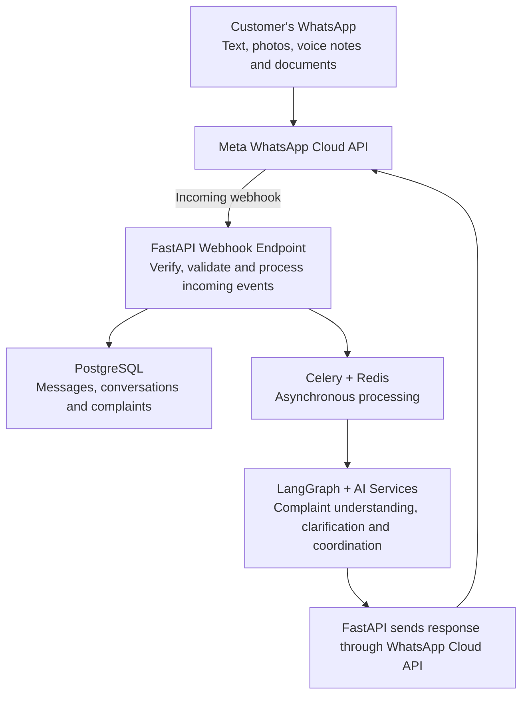
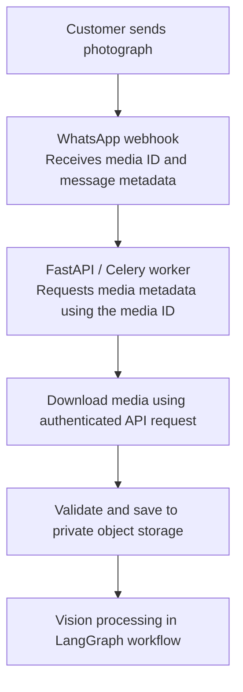
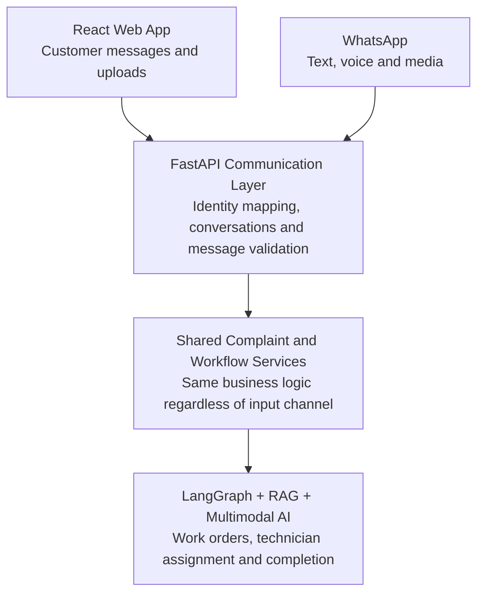

# FieldOps AI — WhatsApp Business Integration and External Services

**FieldOps AI: Autonomous Field-Service Coordination Platform**

This document connects FieldOps AI to WhatsApp. This matters because many customers, particularly in Pakistan and other developing markets, are more comfortable reporting problems through WhatsApp than creating an account on a new website.

The goal is to let customers:

- Submit complaints through WhatsApp.
- Send text, photographs, voice notes and documents.
- Answer AI clarification questions.
- Receive complaint and work-order updates.
- Communicate with the company during the repair process.

Technicians and administrators can also receive relevant notifications.

The recommended approach is to use the official **WhatsApp Business Platform Cloud API**, not unofficial WhatsApp Web automation libraries.

**Contents**

1. [Understanding the WhatsApp Business Platform](#1-understanding-the-whatsapp-business-platform)
2. [Setting up the official integration](#2-setting-up-the-official-whatsapp-integration)
3. [Receiving incoming messages](#3-receiving-incoming-whatsapp-messages)
4. [Understanding webhook payloads](#4-understanding-whatsapp-webhook-payloads)
5. [Connecting WhatsApp messages to customer accounts](#5-connecting-whatsapp-messages-to-customer-accounts)
6. [Handling images, audio and documents](#6-handling-images-audio-and-documents)
7. [Sending WhatsApp messages](#7-sending-whatsapp-messages-from-fieldops-ai)
8. [The 24-hour service window and templates](#8-the-24-hour-customer-service-window-and-message-templates)
9. [Conversation management](#9-whatsapp-conversation-management)
10. [Preventing duplicate webhook processing](#10-preventing-duplicate-webhook-processing)
11. [Delivery and read-status tracking](#11-delivery-and-read-status-tracking)
12. [Human handoff](#12-human-handoff-and-customer-support)
13. [External services and integrations](#13-external-services-and-integrations)
14. [Testing the integration](#14-testing-the-whatsapp-integration)
15. [Implementation sequence](#15-recommended-implementation-sequence)
16. [Official documentation](#16-important-official-documentation)
17. [How WhatsApp fits into FieldOps AI](#17-how-whatsapp-fits-into-fieldops-ai)

---

## 1. Understanding the WhatsApp Business Platform

WhatsApp Business Platform is Meta's official platform for businesses to communicate with customers programmatically. It allows the backend to send and receive WhatsApp messages through APIs and webhooks. Two concepts are important:

- **Cloud API:** used by the backend to send messages and manage media.
- **Webhooks:** used by Meta to notify the backend about incoming messages and message-status events.

These connect WhatsApp with FastAPI.

### High-level architecture



WhatsApp is another input and output channel for the same FieldOps AI platform. A separate AI system should not be built for WhatsApp. A complaint submitted through the website and a complaint submitted through WhatsApp should eventually use the same complaint-management services and LangGraph workflow.

## 2. Setting up the official WhatsApp integration

To integrate the Cloud API, a Meta developer application and the appropriate WhatsApp Business account configuration are needed. The main concepts:

| Term | Meaning |
| --- | --- |
| Meta Developer App | Application registered with Meta |
| WhatsApp Business Account (WABA) | Business account associated with WhatsApp |
| Phone Number ID | Identifier for the business phone number |
| Access Token | Credential used by the backend to call Meta APIs |
| Webhook URL | Public endpoint that receives events |
| Verify Token | Secret value used during webhook subscription verification |
| App Secret | Used to validate webhook signatures |

For development, Meta's test resources can be used where available. For production, an appropriately configured business account, phone number, permissions and access token are needed.

> The access token must not be put in React or exposed to the browser. It stays on the backend in a secret manager or protected environment configuration.

## 3. Receiving incoming WhatsApp messages

Suppose a customer sends:

> My solar inverter stopped working. The red light is blinking.

Meta sends a webhook event to the backend. A public HTTPS endpoint is needed, for example:

```
POST /api/v1/webhooks/whatsapp
```

The FastAPI application receives the event and processes it.

### 3.1 Webhook verification

There are two different operations that developers often confuse.

**Operation A: webhook subscription verification.** When configuring a webhook, Meta sends a GET request containing parameters such as:

- `hub.mode`
- `hub.verify_token`
- `hub.challenge`

The backend checks whether the verification token matches the secret it configured. If it matches, the backend returns the challenge value. Conceptual FastAPI example:

```python
from fastapi import APIRouter, Request, HTTPException
from fastapi.responses import PlainTextResponse

router = APIRouter()


@router.get("/webhooks/whatsapp")
async def verify_webhook(request: Request):
    params = request.query_params

    mode = params.get("hub.mode")
    token = params.get("hub.verify_token")
    challenge = params.get("hub.challenge")

    if (
        mode == "subscribe"
        and token == settings.WHATSAPP_VERIFY_TOKEN
    ):
        return PlainTextResponse(challenge)

    raise HTTPException(
        status_code=403,
        detail="Webhook verification failed"
    )
```

This is a subscription handshake, not proof that every future incoming POST request is authentic.

**Operation B: incoming webhook signature verification.** For incoming POST events, the `X-Hub-Signature-256` header must be verified using HMAC-SHA256 and the Meta App Secret. The signature must be calculated over the original, unmodified request body. Conceptual implementation:

```python
import hashlib
import hmac


def verify_signature(
    raw_body: bytes,
    signature: str | None,
    app_secret: str,
) -> bool:
    if not signature:
        return False

    expected = "sha256=" + hmac.new(
        app_secret.encode(),
        raw_body,
        hashlib.sha256
    ).hexdigest()

    return hmac.compare_digest(
        expected,
        signature
    )
```

The JSON must not be parsed and re-serialized before calculating the signature; even harmless formatting changes can produce a different hash. The check should also fail closed in production: missing or invalid signatures must be rejected.

### 3.2 Receiving the event

After verifying the signature, the endpoint can parse the JSON payload. Conceptually:

```python
@router.post("/webhooks/whatsapp")
async def receive_whatsapp_webhook(request: Request):
    raw_body = await request.body()

    signature = request.headers.get(
        "X-Hub-Signature-256"
    )

    if not verify_signature(
        raw_body,
        signature,
        settings.WHATSAPP_APP_SECRET
    ):
        raise HTTPException(status_code=401)

    payload = await request.json()

    await process_webhook_event(payload)

    return {"status": "received"}
```

This is illustrative. For production, the endpoint should persist or durably enqueue verified events before returning success, rather than performing slow media downloads or AI processing inside the webhook request.

## 4. Understanding WhatsApp webhook payloads

A webhook payload can contain different kinds of events. The most important for this application:

1. Incoming customer messages.
2. Outgoing message status updates.
3. Other account or phone-number events that may need to be monitored.

An incoming text message has a structure conceptually similar to this (a simplified illustrative payload, not a complete schema):

```json
{
  "object": "whatsapp_business_account",
  "entry": [
    {
      "changes": [
        {
          "field": "messages",
          "value": {
            "messages": [
              {
                "from": "923001234567",
                "id": "wamid.example123",
                "timestamp": "1793700000",
                "type": "text",
                "text": {
                  "body": "My inverter is not working."
                }
              }
            ]
          }
        }
      ]
    }
  ]
}
```

The important fields:

| Field | Purpose |
| --- | --- |
| `from` | Customer's WhatsApp identifier |
| `id` | Unique WhatsApp message ID |
| `timestamp` | Message timestamp |
| `type` | Message type |
| `text.body` | Text content, when applicable |

The actual event can contain multiple entries, changes, messages, or status updates. The parser must handle collections rather than assuming there will always be exactly one message.

### Message type handling

| Message type | What FieldOps AI does |
| --- | --- |
| Text | Extract customer description |
| Image | Download and analyze photograph |
| Audio | Download and transcribe voice note |
| Document | Validate and process permitted documents |
| Interactive | Process button or list selection |
| Location | Extract location if supported and consented to |

Unknown or unsupported message types should be handled safely. The webhook processor must not crash because a customer sends an unexpected attachment.

## 5. Connecting WhatsApp messages to customer accounts

This is an important database-design issue. Suppose Ahmed sends a WhatsApp message from:

```
+92 300 1234567
```

How does FieldOps AI know which customer account this belongs to? A reliable mapping is needed. A useful database design includes a `customer_channels` table:

| Column | Purpose |
| --- | --- |
| `id` | Internal record ID |
| `customer_id` | Related customer |
| `channel` | WHATSAPP |
| `external_user_id` | WhatsApp customer identifier |
| `verified_at` | When ownership was verified |
| `created_at` | Registration time |

A uniqueness constraint should be added for the channel and external user identifier within the appropriate business account or tenant.

### Customer identification flow

1. Receive the incoming WhatsApp message.
2. Extract the sender's WhatsApp identifier.
3. Look up the associated customer-channel record.
4. If the identity is verified, load the customer account.
5. If no verified mapping exists, start a controlled registration or account-linking process.
6. Associate the conversation with the customer only after the required identity checks.

Knowing someone's phone number should not be assumed to be sufficient authorization to access all their equipment and service history. For a stronger identity check, WhatsApp can be linked to an existing web account using a one-time verification process.

### What if the customer has multiple complaints?

A single customer may have a solar inverter problem, a battery problem, and a separate maintenance request. A customer must therefore be distinguished from a conversation and a complaint. A suitable relationship:

```
Customer
   |
   +---- Conversation A
   |          |
   |          +---- Messages
   |          |
   |          +---- Complaint A
   |
   +---- Conversation B
              |
              +---- Messages
              |
              +---- Complaint B
```

A message should not automatically create a new complaint every time it arrives. The system must determine whether the message:

- Continues an existing complaint.
- Answers a pending clarification question.
- Reports a separate problem.
- Is a general support message.

For ambiguous messages, the customer should be asked which issue they are referring to.

## 6. Handling images, audio and documents

This is where the WhatsApp integration connects to the multimodal architecture. Suppose Ahmed sends a photograph of an inverter error indicator. WhatsApp doesn't simply send the image bytes inside the normal text field. The webhook provides media-related information, including a media ID, and the backend must retrieve the actual media.

### 6.1 Image retrieval flow



The process involves two API operations:

1. Request media information using its media ID.
2. Use the returned media URL to download the actual file with the required authorization.

The download URL is temporary, so the file should be retrieved promptly and stored securely. That temporary URL must not be saved as the permanent media reference.

### 6.2 Audio processing

Suppose Ahmed sends a WhatsApp voice note:

> My inverter keeps making a sound and the red light is blinking.

The processing flow:

1. Receive the audio message event.
2. Retrieve the audio media.
3. Validate the file and format.
4. Store it privately.
5. Send it to the speech-to-text service.
6. Save the original audio reference and transcript.
7. Pass the transcript into the complaint investigation workflow.

The existing multimodal architecture handles the rest.

### 6.3 Document processing

Customers or technicians might also send equipment invoices, warranty documents, equipment specification sheets or previous maintenance reports. The backend should not automatically trust every document. It should validate file type, size and purpose, and only ingest appropriate technical documents into the knowledge base through an authorized document-ingestion process. A customer's invoice, for example, is evidence about their purchase; it is not automatically an approved manufacturer repair manual.

## 7. Sending WhatsApp messages from FieldOps AI

Receiving messages is only half of the integration; the backend also needs to send messages. The Cloud API provides an endpoint conceptually like:

```
POST https://graph.facebook.com/{API_VERSION}/{PHONE_NUMBER_ID}/messages
```

The API version supported by the configured Meta application should be used and kept in configuration rather than hardcoded throughout the application. A simple text-message payload:

```json
{
  "messaging_product": "whatsapp",
  "recipient_type": "individual",
  "to": "923001234567",
  "type": "text",
  "text": {
    "body": "Your complaint has been received."
  }
}
```

A simplified Python implementation using HTTPX:

```python
import httpx


async def send_whatsapp_text(
    recipient: str,
    message: str,
):
    url = (
        f"{settings.WHATSAPP_API_BASE}/"
        f"{settings.WHATSAPP_API_VERSION}/"
        f"{settings.WHATSAPP_PHONE_NUMBER_ID}/messages"
    )

    headers = {
        "Authorization": (
            f"Bearer {settings.WHATSAPP_ACCESS_TOKEN}"
        ),
        "Content-Type": "application/json",
    }

    payload = {
        "messaging_product": "whatsapp",
        "recipient_type": "individual",
        "to": recipient,
        "type": "text",
        "text": {
            "body": message
        }
    }

    async with httpx.AsyncClient(timeout=20) as client:
        response = await client.post(
            url,
            headers=headers,
            json=payload,
        )

    response.raise_for_status()

    return response.json()
```

This function is illustrative. A production messaging service should also handle API errors, retries, timeouts, message IDs, delivery tracking and rate limits.

### What messages should FieldOps AI send?

**Complaint acknowledgement**

```
Your complaint has been received.

Complaint ID: FO-1024

Our system is reviewing the information you provided.
```

**Clarification question**

```
Could you please share the model number
shown on your inverter's label?
```

**Work-order creation**

```
A maintenance work order has been created.

Work Order: WO-1024
Status: Technician assignment pending
```

**Technician assignment**

```
A technician has been assigned to your complaint.

Your work order is now assigned.
```

**Completion update**

```
Your maintenance request has been marked complete.

You can view the repair summary through
your FieldOps AI customer portal.
```

These are operational messages. Technical conclusions should not be sent to customers unless they are supported by the investigation and appropriately reviewed.

## 8. The 24-hour customer service window and message templates

> **Important platform constraint.** This is one of the most important WhatsApp rules for the architecture.

When a customer messages the business, a 24-hour customer service window opens or resets from that incoming message. During this window, the business can generally send free-form messages. Outside that window, the business must use an approved message template to initiate or resume communication. The customer must also have provided the required opt-in for business messaging.

This is particularly important for FieldOps AI because maintenance jobs can take days to complete. For example:

- Monday: customer reports a problem.
- Monday: AI asks for clarification.
- Monday: customer responds.
- Tuesday: technician is assigned.
- Wednesday: technician visits the customer.
- Thursday: repair is completed.

The original 24-hour window will not remain open throughout the whole repair process just because the complaint is still active. A later customer message opens a new window, but if the customer hasn't messaged again, an appropriate approved template is required for a business-initiated update. Meta's policy also requires a clear human escalation path when automation is used.

### 8.1 Templates for FieldOps AI

Templates should be prepared for important operational notifications.

| Template | Category to submit for review | Example |
| --- | --- | --- |
| Complaint acknowledgement | Utility, subject to Meta classification | Complaint received |
| Technician assignment | Utility | Technician assigned |
| Appointment reminder | Utility | Upcoming service visit |
| Job completion | Utility | Work order completed |
| Authentication code | Authentication | Account verification |

The category is ultimately determined through Meta's template review and classification. It should not be assumed that a template will be approved under the category chosen. A possible template:

```
Hello {{1}},

Your FieldOps AI work order {{2}}
has been updated.

Current status: {{3}}

You can view details using your customer portal.
```

Templates need to be submitted and approved before production use.

### 8.2 Why this affects the backend design

Communication information needs to be maintained in the database. For example:

```
conversation_id
customer_id
channel
external_user_id
last_inbound_message_at
service_window_expires_at
```

Before sending a message, the backend should check:

1. Is the recipient's identity and contact record valid?
2. Has the customer opted in to the relevant communication?
3. Is the customer service window active?
4. Is this message permitted as a free-form message?
5. If the window is closed, is there an approved template for this purpose?
6. Is the message appropriate for this customer and complaint?

> The AI agent should not decide to bypass these rules. They belong in the messaging service.

## 9. WhatsApp conversation management

A proper messaging architecture is needed, not just a function that sends and receives text. A customer may send many messages before a work order is created. For example:

```
Customer:
My inverter stopped working.

FieldOps AI:
Can you share a photograph of the inverter display?

Customer:
[Photograph]

FieldOps AI:
Can you confirm the model number?

Customer:
Solis S6.

FieldOps AI:
Thank you. I'm checking the relevant documentation.
```

All these messages should belong to the appropriate conversation and complaint.

### Recommended database tables

**`conversations`**

```
id
customer_id
channel
external_conversation_id
status
last_message_at
created_at
```

**`messages`**

```
id
conversation_id
complaint_id
sender_type
external_message_id
message_type
content
delivery_status
created_at
```

**`complaint_attachments`**

```
id
complaint_id
message_id
storage_key
media_type
file_size
processing_status
created_at
```

A unique constraint should be added on the external WhatsApp message ID for inbound messages, which is useful for deduplication. Outgoing messages and their WhatsApp message IDs should also be kept so delivery events can update the correct database record.

### Important: distinguish messages from workflow events

A customer message is not necessarily a new complaint. A message could be:

- A response to a clarification question.
- A new maintenance request.
- A question about an existing work order.
- A request to speak with a human.
- A general conversation.

Complaint and conversation context can be used to determine its purpose. When the context is ambiguous, the customer should be asked rather than silently attaching the message to the wrong job.

## 10. Preventing duplicate webhook processing

This is a critical reliability issue. Webhook providers may retry event delivery, so the backend must not assume every event will arrive exactly once. Suppose Meta delivers the same incoming message twice. Without deduplication, FieldOps AI might:

- Save two copies of the message.
- Trigger two AI investigations.
- Ask the customer the same clarification twice.
- Create duplicate work orders.
- Send duplicate notifications.

This can be prevented using the unique external message ID. Conceptual database constraint:

```sql
CREATE UNIQUE INDEX unique_external_message
ON messages (external_message_id)
WHERE external_message_id IS NOT NULL;
```

A robust processing flow:

1. Receive webhook.
2. Verify its signature.
3. Extract the external event/message ID.
4. Persist the event or message using a unique constraint.
5. If it already exists, don't process it again.
6. If it is new, enqueue its processing.
7. Return a successful HTTP response after durable acceptance.

For stronger reliability, a database-backed webhook inbox or transactional outbox pattern can be used.

### Why not process everything inside the webhook?

Imagine a voice note takes 15 seconds to transcribe. The webhook request should not remain open while transcription, vision analysis and RAG run. Instead:

- Verify the webhook.
- Persist the event.
- Enqueue a background job.
- Return a success response promptly.
- Process the message asynchronously.

If processing fails, the internal job system can retry it without requiring the webhook endpoint to repeat the entire AI workflow. Each downstream operation should also be made idempotent: deduplicating the incoming message alone does not prevent duplicate effects if a worker retries after partially completing its work.

## 11. Delivery and read-status tracking

Sending a WhatsApp message successfully does not necessarily mean the customer received or read it. The API response generally gives a WhatsApp message ID. Later, status webhook events can report delivery progress. Common statuses:

- `sent`
- `delivered`
- `read`
- `failed`

The backend should update the outgoing message record using the corresponding WhatsApp message ID. For example:

```
Message:
Your technician has been assigned.

WhatsApp message ID:
wamid.example123

Delivery status:
DELIVERED
```

If the message fails, the error information should be recorded and a decision made on whether retrying is appropriate. Permanent errors such as invalid recipients or rejected templates should not be endlessly retried.

This is also why message status should be maintained separately from complaint status. A complaint may be `ASSIGNED` even if its notification failed to send. The repair operation and the communication operation are related, but they are not the same thing.

## 12. Human handoff and customer support

The project is designed for autonomous workflow execution, with human intervention when necessary, and WhatsApp must support that. Consider these situations:

- Customer requests a human representative.
- The AI cannot identify the equipment.
- The complaint involves a potential electrical safety issue.
- Technical documents provide conflicting instructions.
- The customer disputes the AI's interpretation.
- The system cannot find a qualified technician.

In these cases, FieldOps AI should escalate the conversation. A possible workflow:

```
Customer message
      |
      v
AI processes request
      |
      v
Does the workflow need escalation?
      |
   +--+--+
   |     |
  No    Yes
   |     |
   v     v
Continue  Create support task
workflow  and notify staff
   |     |
   v     v
Respond   Human reviews case
         |
         v
         Resolution recorded
         |
         v
         Workflow resumes
```

For a human handoff, store:

- Escalation reason.
- Assigned support employee.
- Conversation status.
- Relevant complaint and work-order IDs.
- Previous AI findings.
- Human resolution.
- Whether the AI workflow can resume.

The customer should know that their request has been escalated rather than receiving repeated automated responses.

## 13. External services and integrations

WhatsApp is not the only external service FieldOps AI may need.

| External service | Purpose | Priority |
| --- | --- | --- |
| WhatsApp Cloud API | Customer messaging | High |
| LLM provider | Complaint understanding and reasoning | High |
| Speech-to-text provider | Voice transcription | High |
| Object storage | Image, audio and document storage | High |
| Email provider | Internal notifications and account communication | Medium |
| Maps/geocoding API | Technician location and service-area information | Later |
| SMS provider | Optional fallback notifications | Later |
| Payment gateway | Not needed for initial MVP | Low |

### Integration design

External API calls should not be written directly inside every business service. Instead, dedicated integration modules should be created:

```
integrations/
│
├── whatsapp/
│   ├── client.py
│   ├── webhooks.py
│   ├── messages.py
│   └── media.py
│
├── llm/
│   └── client.py
│
├── storage/
│   └── client.py
│
├── speech/
│   └── transcription.py
│
└── email/
    └── client.py
```

This has two benefits:

1. An external provider can be changed without rewriting the entire application.
2. Business logic can be tested without making real external API calls.

For example, the complaint workflow should call an application-level messaging service. That service can choose WhatsApp, web chat or another communication channel based on the customer's registered channel and permissions.

## 14. Testing the WhatsApp integration

The integration should be tested independently before connecting it to the complete AI system.

### Test cases

| Test | Expected result |
| --- | --- |
| Valid incoming text message | Message stored |
| Invalid webhook signature | Request rejected |
| Duplicate message ID | No duplicate processing |
| Incoming photograph | Media downloaded and stored |
| Incoming voice note | Audio stored and transcription scheduled |
| Unsupported attachment | Safely rejected |
| Customer without account mapping | Registration/linking process started |
| Active 24-hour window | Permitted free-form reply sent |
| Expired 24-hour window | Approved template required |
| Invalid template | Error recorded and handled |
| Message delivered | Delivery status updated |
| Message failed | Failure recorded |
| Customer requests human | Escalation created |
| Customer responds to clarification | Correct workflow resumed |

### Development testing

For development, a public HTTPS webhook URL is needed. A local backend running on `http://localhost:8000` is not directly reachable by Meta. A secure tunneling service can be used during development to expose the local server through an HTTPS URL; a temporary tunnel can forward incoming webhook requests to the FastAPI application.

The development database or administrative endpoints must not be exposed publicly. For production, the system should be deployed behind a properly configured HTTPS reverse proxy or hosting platform with protected secrets.

## 15. Recommended implementation sequence

WhatsApp is implemented in five phases.

### Phase 1 — Basic WhatsApp connection

- Configure the Meta developer application.
- Configure the WhatsApp Business account and test number.
- Create the FastAPI webhook endpoint.
- Implement GET verification and POST signature validation.
- Receive and store text messages.

### Phase 2 — Customer and conversation management

- Link WhatsApp identities to customer accounts.
- Create conversations.
- Store incoming and outgoing messages.
- Implement duplicate-event protection.

### Phase 3 — Multimodal messaging

- Download photographs.
- Download voice notes.
- Implement transcription.
- Connect attachments to complaints.
- Integrate with the existing multimodal AI workflow.

### Phase 4 — AI communication

- Send complaint acknowledgements.
- Send clarification questions.
- Process customer replies.
- Resume LangGraph workflows.
- Implement human escalation.

### Phase 5 — Production readiness

- Create and approve message templates.
- Track message delivery.
- Configure retry and error handling.
- Secure access tokens and media.
- Test webhook reliability.
- Monitor messaging costs and usage.

Phases 1–4 should be completed before spending much time on advanced WhatsApp features.

## 16. Important official documentation

Meta's official documentation should be the primary implementation reference:

1. [WhatsApp Cloud API](https://developers.facebook.com/docs/whatsapp/cloud-api/)
2. [WhatsApp Webhooks](https://developers.facebook.com/docs/whatsapp/cloud-api/webhooks)
3. [WhatsApp Messages API](https://developers.facebook.com/docs/whatsapp/cloud-api/reference/messages)
4. [WhatsApp Media API](https://developers.facebook.com/docs/whatsapp/cloud-api/reference/media)
5. [WhatsApp Business Messaging Policy](https://whatsappbusiness.com/policy/)
6. [WhatsApp Message Templates](https://developers.facebook.com/docs/whatsapp/business-management-api/message-templates/)

The customer service window and template requirements are platform rules, not optional implementation choices. Meta's current policy should be reviewed before deploying because messaging policies, permissions, API versions and pricing can change.

## 17. How WhatsApp fits into FieldOps AI

The complete communication architecture: one platform, two customer channels.



The most important architectural decision is that WhatsApp should remain a communication channel, not become a separate business-logic system. A complaint submitted through WhatsApp should receive the same validation, AI investigation, safety checks, work-order handling and audit logging as a complaint submitted through the web application.

> WhatsApp integration may look like a messaging feature, but it introduces identity, privacy, duplicate-event, asynchronous processing and policy-compliance problems. It should be treated as a proper backend integration, not just a chatbot connected to a phone number.
